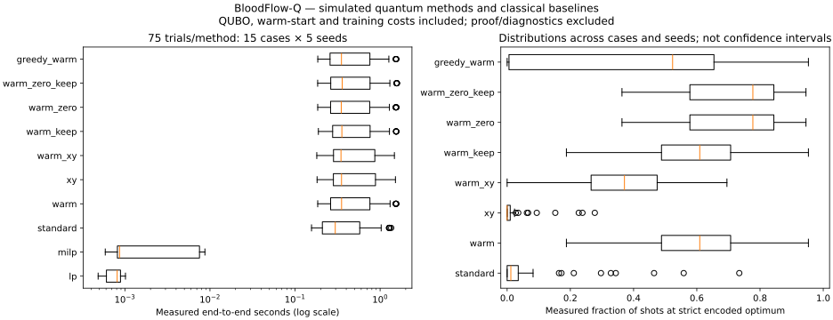

# BloodFlow-Q Experiment Results

<!-- BEGIN FULL REVIEW 20261024 -->

## October 24, 2026 — fresh full-repository review

This section is generated from recorded local runs. Historical results below remain separate. All quantum execution is simulated; no hardware speedup or quantum advantage is established. The current linear allocation problem has a strong integral LP/min-cost-flow baseline. Warm preparation and optimizer parameter initialization are distinct algorithm choices.

Primary raw evidence: [experiments/results/full_review_20261024/production_v2/runs.jsonl](../experiments/results/full_review_20261024/production_v2/runs.jsonl). Configuration/environment: [experiments/results/full_review_20261024/production_v2/protocol.json](../experiments/results/full_review_20261024/production_v2/protocol.json). Machine-readable summaries: [experiments/results/full_review_20261024/production_v2/summary.json](../experiments/results/full_review_20261024/production_v2/summary.json). Raw SHA-256: `2837dcf1b305d2d2a385f49ec1b39d6c56f3386b2e0df3579aba54a65ae31abf`.

### Methodology and source provenance

The objective minimizes priority-weighted shortage, total shortage and per-unit transportation burdens. Supply and demand constraints use shortened binary shipment/shortage/slack registers in production QAOA. Exact enumeration verifies small formulations, MILP/LP and greedy provide classical references. Synthetic cases, weights, penalty strengths and qubit counts are saved in each `*_case.json`; every `*_proof.json` preserves its exhaustive energy-equivalence check. See [mathematical audit](mathematical_model_audit.md) and [primary-literature review](quantum_research_review.md) for equations and citations, including Egger warm-start QAOA, Hadfield constrained mixers, and Zhou parameter interpolation.

```json
{
  "configuration": {
    "study": "full_review_20261024",
    "primary_seeds": [
      401,
      402,
      403,
      404,
      405
    ],
    "additional_seeds": [
      401,
      402,
      403
    ],
    "base": {
      "p": 2,
      "shots": 256,
      "max_iterations": 40,
      "restarts": 2,
      "warm_start_epsilon": 0.1,
      "normalize_cost": true
    },
    "max_qubits": 14,
    "run_timeout_seconds": 60,
    "primary_variants": {
      "standard": {},
      "warm": {
        "warm_start": true
      },
      "xy": {
        "mixer": "xy"
      },
      "warm_xy": {
        "warm_start": true,
        "mixer": "xy"
      },
      "warm_keep": {
        "warm_start": true,
        "retain_initial_state": true
      },
      "warm_zero": {
        "warm_start": true,
        "parameter_initialization": "zero_first"
      },
      "warm_zero_keep": {
        "warm_start": true,
        "parameter_initialization": "zero_first",
        "retain_initial_state": true
      },
      "greedy_warm": {
        "warm_start": true,
        "warm_start_source": "greedy"
      }
    },
    "ablation_scenarios": [
      "normal_reference",
      "emergency_16",
      "multi_facility"
    ],
    "ablations": {
      "warm_epsilon025": {
        "warm_start": true,
        "warm_start_epsilon": 0.25
      },
      "warm_depth1": {
        "warm_start": true,
        "p": 1
      },
      "warm_depth3": {
        "warm_start": true,
        "p": 3
      },
      "warm_shots64": {
        "warm_start": true,
        "shots": 64
      },
      "warm_powell": {
        "warm_start": true,
        "optimizer": "Powell",
        "max_iterations": 2
      },
      "warm_nelder_mead": {
        "warm_start": true,
        "optimizer": "Nelder-Mead"
      },
      "warm_interpolated": {
        "warm_start": true,
        "parameter_initialization": "provided"
      }
    },
    "notes": [
      "Frozen before measuring new controls. Five paired optimizer seeds on the 15 established compact/held-out cases; three on additional boundary and historical cases.",
      "Only primary warm_keep versus warm is a mechanistic expected-energy retention check; other contrasts exploratory. Retention costs one extra statevector evaluation.",
      "Powell iteration budgets are not equivalent to COBYLA function budgets; actual calls and time are reported.",
      "Depth interpolation includes a separate p=1 training run on the same instance/seed and charges its entire runtime.",
      "Exact references and validation are separately timed analysis work; not part of solver wall time. No hardware runtime inferred."
    ]
  },
  "pilot": false,
  "source_sha256": {
    "quantum/qaoa_solver.py": "0dbd09fa30a15d219b4d6099051648caab691ee6800e01cd5f8919aaacab10fe",
    "quantum/qubo.py": "2e26596a8dbb965e210908eef4cebf7305283a6b3ec9930a7a1a9b1aaf7f4bbe",
    "quantum/ising.py": "38b70015db5f2197b35179c97fc656664d33c8969140411d59bd20d4694284dc",
    "optimization/milp.py": "72bd813791bd21ab8a8822b316e9d12f7acf7a1f16f5a4dc39b02b6f72aeff86",
    "optimization/decoder.py": "e8b303e9d30c5a1562a8101e21c2967cba9839d669594acd296aa8a369f08199",
    "optimization/constraints.py": "3c5c7e04c11fb90a019de52c159555a29e14f9f2586ec0242cf46f8a878f3818",
    "optimization/objective.py": "cc612ba79c819ae388d0dc4f87af8e014c764391242e5bd7c92bc58b004ac2d5",
    "experiments/run_full_review.py": "99289b64f49ec2241e53968f5478b7443f7e83e783aa562dfcc3989563090309",
    "experiments/configs/full_review_20261024.json": "c1a18d713f36b7a1e3e5b80c25fbdbf0ff4e279234218279ecd53cea428ad018"
  },
  "python": "3.14.7",
  "platform": "macOS-27.0.1-arm64-arm-64bit-Mach-O",
  "machine": "arm64",
  "cpu_count": 10,
  "versions": {
    "numpy": "2.5.4",
    "scipy": "1.18.1",
    "qiskit": "2.6.0",
    "qiskit-aer": "0.17.2"
  },
  "thread_limits": {
    "OMP_NUM_THREADS": "1",
    "OPENBLAS_NUM_THREADS": "1"
  },
  "timing": "serial warm-process timings; repetitions are not independent problem instances; ru_maxrss is process lifetime high-water; references and analysis are excluded and separately timed",
  "hardware": "Apple M1 Pro\n17179869184"
}
```

The production_v2 protocol/source_snapshot preserves the module versions imported when that process started. Its MILP snapshot predates the all-zero-demand corner correction. Those original boundary rows remain evidence; the separately recorded `boundary_corrected` family must be used for corrected-source behavior and is never silently pooled. Source hashes identify recorded coverage, not an assertion that every dependency or the current checkout is unchanged.

### Execution coverage and metric definitions

Recorded primary-runner outcomes: `{"completed": 1377, "skipped": 33}` across 1410 records. Completed means a run returned; inspect optimizer success/convergence separately. Failures, explicit unsupported skips, and resource limits remain in the raw ledger.

feasible_shot_rate is operational allocation/shortage feasibility; final_feasible_probability and optimal_shot_rate use strict encoded equality proof masks. Statistics use only finite recorded values, with n per metric. Feasibility mean is returned-solution feasibility, distinct from feasible-shot rate. Sample standard deviation uses n-1 and is null for n<2. Aggregate methods use primary-family rows only; ablations have fewer scenarios and must not be ranked against full methods. Runtime/objective means across different instances are descriptive, not paired significance evidence. Failed/skipped rows remain in status counts; missing metrics are never zero.

Tables report mean / median / sample standard deviation (n−1 denominator), with the actual nonmissing n. Missing metrics are not zero. Feasibility is returned operational allocation feasibility; feasible-shot rate uses the shipment/shortage validator and does not require encoded slack equality. Ideal final_feasible_probability and optimal_shot_rate use strict encoded proof masks. Objective gaps are absolute, reference-dependent and absent when no valid reference/comparison exists. Different scenarios have different objective scales.

End-to-end `wall_seconds` charges QUBO construction, warm preprocessing, optimizer work, circuit construction, simulation, final sampling/postprocessing and parameter-training overhead where applicable. Independent exact proofs and diagnostic probability analysis are excluded and timed separately. Circuit/statevector timing is nested inside inclusive optimization time: do not sum overlapping fields. Peak RSS is a process-lifetime high-water mark, not isolated per-run allocation. Serial fixed-seed repetitions share machine/cache conditions and are not independent problem instances. This small fixed corpus does not justify population confidence claims.

### Primary methods and classical baselines

Completed-run statistics; all outcomes remain in the status column. Do not rank the smaller ablations against methods covering a different case set.

| Method | Scenarios | Statuses | Runtime s mean/median/SD (n) | Feasible/evaluated | Operational shot rate mean/median/SD (n) | Absolute gap mean/median/SD (n) | Missing gap |
| --- | --- | --- | --- | --- | --- | --- | --- |
| exact | 15 | {"completed": 75} | 0.000268397 / 0.000132625 / 0.000292674 (n=75) | 75/75 | not measured / not measured / not measured (n=0) | not measured / not measured / not measured (n=0) | 75 |
| greedy | 15 | {"completed": 75} | 5.46818e-05 / 5.25e-05 / 1.95553e-05 (n=75) | 75/75 | not measured / not measured / not measured (n=0) | not measured / not measured / not measured (n=0) | 75 |
| greedy_warm | 15 | {"completed": 75} | 0.560725 / 0.351277 / 0.426873 (n=75) | 75/75 | 0.711823 / 0.722656 / 0.142022 (n=75) | 0.304 / 0 / 0.86093 (n=75) | 0 |
| lp | 15 | {"completed": 75} | 0.000771025 / 0.0008105 / 0.000152223 (n=75) | 75/75 | not measured / not measured / not measured (n=0) | not measured / not measured / not measured (n=0) | 75 |
| milp | 15 | {"completed": 75} | 0.00275895 / 0.000865875 / 0.00315365 (n=75) | 75/75 | not measured / not measured / not measured (n=0) | not measured / not measured / not measured (n=0) | 75 |
| standard | 15 | {"completed": 75} | 0.457876 / 0.296949 / 0.348486 (n=75) | 75/75 | 0.33401 / 0.253906 / 0.231783 (n=75) | 2.76533 / 0 / 9.2232 (n=75) | 0 |
| warm | 15 | {"completed": 75} | 0.562335 / 0.352367 / 0.427962 (n=75) | 75/75 | 0.714375 / 0.71875 / 0.146256 (n=75) | 0 / 0 / 0 (n=75) | 0 |
| warm_keep | 15 | {"completed": 75} | 0.567562 / 0.355259 / 0.430753 (n=75) | 75/75 | 0.714375 / 0.71875 / 0.146256 (n=75) | 0 / 0 / 0 (n=75) | 0 |
| warm_xy | 15 | {"completed": 75} | 0.580841 / 0.34695 / 0.432836 (n=75) | 75/75 | 0.54599 / 0.574219 / 0.174086 (n=75) | 0.989333 / 0 / 4.8916 (n=75) | 0 |
| warm_zero | 15 | {"completed": 75} | 0.560593 / 0.349419 / 0.428101 (n=75) | 75/75 | 0.822396 / 0.859375 / 0.119853 (n=75) | 0 / 0 / 0 (n=75) | 0 |
| warm_zero_keep | 15 | {"completed": 75} | 0.567166 / 0.358619 / 0.435216 (n=75) | 75/75 | 0.822396 / 0.859375 / 0.119853 (n=75) | 0 / 0 / 0 (n=75) | 0 |
| xy | 15 | {"completed": 75} | 0.584616 / 0.351913 / 0.4359 (n=75) | 75/75 | 0.196458 / 0.148438 / 0.156704 (n=75) | 5.60533 / 0 / 17.7166 (n=75) | 0 |


### Smaller-scope parameter/depth/shot ablations

Completed-run statistics; all outcomes remain in the status column. Do not rank the smaller ablations against methods covering a different case set.

| Method | Scenarios | Statuses | Runtime s mean/median/SD (n) | Feasible/evaluated | Operational shot rate mean/median/SD (n) | Absolute gap mean/median/SD (n) | Missing gap |
| --- | --- | --- | --- | --- | --- | --- | --- |
| warm_depth1 | 3 | {"completed": 15} | 0.696812 / 0.788962 / 0.249307 (n=15) | 15/15 | 0.571094 / 0.589844 / 0.114784 (n=15) | 0 / 0 / 0 (n=15) | 0 |
| warm_depth3 | 3 | {"completed": 15} | 1.5321 / 1.73623 / 0.612399 (n=15) | 15/15 | 0.538021 / 0.496094 / 0.179727 (n=15) | 0 / 0 / 0 (n=15) | 0 |
| warm_epsilon025 | 3 | {"completed": 15} | 1.13128 / 1.27248 / 0.431485 (n=15) | 15/15 | 0.258594 / 0.269531 / 0.138392 (n=15) | 0 / 0 / 0 (n=15) | 0 |
| warm_interpolated | 3 | {"completed": 15} | 1.81988 / 2.04761 / 0.686362 (n=15) | 15/15 | 0.655729 / 0.644531 / 0.142235 (n=15) | 0 / 0 / 0 (n=15) | 0 |
| warm_nelder_mead | 3 | {"completed": 15} | 1.81271 / 2.0323 / 0.737265 (n=15) | 15/15 | 0.517969 / 0.460938 / 0.143044 (n=15) | 0 / 0 / 0 (n=15) | 0 |
| warm_powell | 3 | {"completed": 15} | 2.15563 / 2.4513 / 0.873623 (n=15) | 15/15 | 0.613802 / 0.648438 / 0.085261 (n=15) | 0 / 0 / 0 (n=15) | 0 |
| warm_shots64 | 3 | {"completed": 15} | 1.11685 / 1.26149 / 0.427695 (n=15) | 15/15 | 0.570833 / 0.515625 / 0.12386 (n=15) | 0 / 0 / 0 (n=15) | 0 |


### Matched guard ablations (exploratory)

Pairs match scenario and seed among completed primary-family runs. Differences below are treatment minus control; negative runtime/energy/gap differences favor treatment. Seeds within a case are not independent case evidence. No p-values, significance or universal superiority claim is inferred. The guard only ensures ideal expected penalized energy no worse than its initial reference when solver execution succeeds; it does not guarantee optimal-shot rate, returned quality, feasibility or speed.

| Control | Treatment | Metric | Matched runs | Difference mean/median/SD (n) |
| --- | --- | --- | --- | --- |
| warm | warm_keep | wall_seconds | 75 | 0.00522696 / 0.00336183 / 0.0149265 (n=75) |
| warm | warm_keep | final_expected_energy | 75 | 0 / 0 / 0 (n=75) |
| warm | warm_keep | optimal_shot_rate | 75 | 0 / 0 / 0 (n=75) |
| warm | warm_keep | absolute_gap | 75 | 0 / 0 / 0 (n=75) |
| warm_zero | warm_zero_keep | wall_seconds | 75 | 0.00657239 / 0.00464358 / 0.0128359 (n=75) |
| warm_zero | warm_zero_keep | final_expected_energy | 75 | 0 / 0 / 0 (n=75) |
| warm_zero | warm_zero_keep | optimal_shot_rate | 75 | 0 / 0 / 0 (n=75) |
| warm_zero | warm_zero_keep | absolute_gap | 75 | 0 / 0 / 0 (n=75) |
| warm | warm_zero | wall_seconds | 75 | -0.0017417 / -0.000691832 / 0.0106835 (n=75) |
| warm | warm_zero | final_expected_energy | 75 | -702.685 / -39.0172 / 2415.35 (n=75) |
| warm | warm_zero | optimal_shot_rate | 75 | 0.120104 / 0.105469 / 0.148985 (n=75) |
| warm | warm_zero | absolute_gap | 75 | 0 / 0 / 0 (n=75) |


### Timing phases and computational budgets

| Method | Nested phase (seconds) or evaluation count | Mean/median/SD (n) |
| --- | --- | --- |
| greedy_warm | preprocessing_seconds | 0.000548117 / 0.000474708 / 0.00022734 (n=75) |
| greedy_warm | optimization_seconds_inclusive | 0.501158 / 0.294053 / 0.422488 (n=75) |
| greedy_warm | circuit_construction_seconds | 0.0338927 / 0.0303618 / 0.0151753 (n=75) |
| greedy_warm | statevector_simulation_seconds | 0.418799 / 0.215109 / 0.404414 (n=75) |
| greedy_warm | compilation_seconds | 0.0521575 / 0.0520709 / 0.00174942 (n=75) |
| greedy_warm | final_sampling_seconds | 0.0032725 / 0.00222883 / 0.00232067 (n=75) |
| greedy_warm | postprocessing_seconds | 0.00229983 / 0.00176796 / 0.00160693 (n=75) |
| greedy_warm | objective_evaluations_total | 80 / 80 / 0 (n=75) |
| greedy_warm | reference_evaluations | 0 / 0 / 0 (n=75) |
| greedy_warm | function_evaluations | 80 / 80 / 0 (n=75) |
| standard | preprocessing_seconds | 0.000429073 / 0.000383083 / 0.000196687 (n=75) |
| standard | optimization_seconds_inclusive | 0.395162 / 0.235843 / 0.341319 (n=75) |
| standard | circuit_construction_seconds | 0.0228227 / 0.019322 / 0.0116062 (n=75) |
| standard | statevector_simulation_seconds | 0.325249 / 0.168581 / 0.325981 (n=75) |
| standard | compilation_seconds | 0.0521778 / 0.0521302 / 0.00123005 (n=75) |
| standard | final_sampling_seconds | 0.00280928 / 0.00188838 / 0.00198999 (n=75) |
| standard | postprocessing_seconds | 0.00632741 / 0.00512821 / 0.00483584 (n=75) |
| standard | objective_evaluations_total | 80 / 80 / 0 (n=75) |
| standard | reference_evaluations | 0 / 0 / 0 (n=75) |
| standard | function_evaluations | 80 / 80 / 0 (n=75) |
| warm | preprocessing_seconds | 0.00127994 / 0.00119854 / 0.000316159 (n=75) |
| warm | optimization_seconds_inclusive | 0.500911 / 0.293228 / 0.423112 (n=75) |
| warm | circuit_construction_seconds | 0.034098 / 0.0306831 / 0.0149501 (n=75) |
| warm | statevector_simulation_seconds | 0.418694 / 0.215423 / 0.404846 (n=75) |
| warm | compilation_seconds | 0.0528867 / 0.0523575 / 0.00451452 (n=75) |
| warm | final_sampling_seconds | 0.00343034 / 0.0021895 / 0.00266333 (n=75) |
| warm | postprocessing_seconds | 0.00229954 / 0.00175138 / 0.00157949 (n=75) |
| warm | objective_evaluations_total | 80 / 80 / 0 (n=75) |
| warm | reference_evaluations | 0 / 0 / 0 (n=75) |
| warm | function_evaluations | 80 / 80 / 0 (n=75) |
| warm_depth1 | preprocessing_seconds | 0.00157183 / 0.00161454 / 0.000205924 (n=15) |
| warm_depth1 | optimization_seconds_inclusive | 0.634052 / 0.723696 / 0.246285 (n=15) |
| warm_depth1 | circuit_construction_seconds | 0.0309448 / 0.031271 / 0.00603598 (n=15) |
| warm_depth1 | statevector_simulation_seconds | 0.552479 / 0.638704 / 0.237833 (n=15) |
| warm_depth1 | compilation_seconds | 0.0521892 / 0.0520345 / 0.00109112 (n=15) |
| warm_depth1 | final_sampling_seconds | 0.003996 / 0.00430725 / 0.00121044 (n=15) |
| warm_depth1 | postprocessing_seconds | 0.00377011 / 0.00385375 / 0.00133664 (n=15) |
| warm_depth1 | objective_evaluations_total | 79.4 / 80 / 2.06328 (n=15) |
| warm_depth1 | reference_evaluations | 0 / 0 / 0 (n=15) |
| warm_depth1 | function_evaluations | 79.4 / 80 / 2.06328 (n=15) |
| warm_depth3 | preprocessing_seconds | 0.00146231 / 0.00148308 / 0.000212853 (n=15) |
| warm_depth3 | optimization_seconds_inclusive | 1.4626 / 1.6653 / 0.606994 (n=15) |
| warm_depth3 | circuit_construction_seconds | 0.0766093 / 0.0788395 / 0.0152102 (n=15) |
| warm_depth3 | statevector_simulation_seconds | 1.33164 / 1.53122 / 0.589882 (n=15) |
| warm_depth3 | compilation_seconds | 0.0526642 / 0.052334 / 0.00120116 (n=15) |
| warm_depth3 | final_sampling_seconds | 0.00880208 / 0.00990608 / 0.00346491 (n=15) |
| warm_depth3 | postprocessing_seconds | 0.00400872 / 0.00431554 / 0.00180006 (n=15) |
| warm_depth3 | objective_evaluations_total | 80 / 80 / 0 (n=15) |
| warm_depth3 | reference_evaluations | 0 / 0 / 0 (n=15) |
| warm_depth3 | function_evaluations | 80 / 80 / 0 (n=15) |
| warm_epsilon025 | preprocessing_seconds | 0.00157273 / 0.00153608 / 0.000261321 (n=15) |
| warm_epsilon025 | optimization_seconds_inclusive | 1.05642 / 1.19715 / 0.428377 (n=15) |
| warm_epsilon025 | circuit_construction_seconds | 0.0541693 / 0.0554958 / 0.0105711 (n=15) |
| warm_epsilon025 | statevector_simulation_seconds | 0.949317 / 1.08802 / 0.415946 (n=15) |
| warm_epsilon025 | compilation_seconds | 0.054462 / 0.053384 / 0.00627603 (n=15) |
| warm_epsilon025 | final_sampling_seconds | 0.00663984 / 0.0072345 / 0.00237882 (n=15) |
| warm_epsilon025 | postprocessing_seconds | 0.0103458 / 0.0119199 / 0.00329764 (n=15) |
| warm_epsilon025 | objective_evaluations_total | 80 / 80 / 0 (n=15) |
| warm_epsilon025 | reference_evaluations | 0 / 0 / 0 (n=15) |
| warm_epsilon025 | function_evaluations | 80 / 80 / 0 (n=15) |
| warm_interpolated | preprocessing_seconds | 0.00153199 / 0.00153937 / 0.000102743 (n=15) |
| warm_interpolated | optimization_seconds_inclusive | 1.05615 / 1.19891 / 0.43067 (n=15) |
| warm_interpolated | circuit_construction_seconds | 0.0540783 / 0.0551377 / 0.010747 (n=15) |
| warm_interpolated | statevector_simulation_seconds | 0.948614 / 1.08982 / 0.418073 (n=15) |
| warm_interpolated | compilation_seconds | 0.052727 / 0.052591 / 0.00147268 (n=15) |
| warm_interpolated | final_sampling_seconds | 0.00625819 / 0.006963 / 0.00230871 (n=15) |
| warm_interpolated | postprocessing_seconds | 0.00313334 / 0.00271633 / 0.00120168 (n=15) |
| warm_interpolated | objective_evaluations_total | 80 / 80 / 0 (n=15) |
| warm_interpolated | reference_evaluations | 0 / 0 / 0 (n=15) |
| warm_interpolated | function_evaluations | 80 / 80 / 0 (n=15) |
| warm_keep | preprocessing_seconds | 0.00124028 / 0.00119188 / 0.000328593 (n=75) |
| warm_keep | optimization_seconds_inclusive | 0.501619 / 0.29368 / 0.421018 (n=75) |
| warm_keep | circuit_construction_seconds | 0.0341928 / 0.0304091 / 0.0150637 (n=75) |
| warm_keep | statevector_simulation_seconds | 0.424752 / 0.218606 / 0.408334 (n=75) |
| warm_keep | compilation_seconds | 0.0521819 / 0.0521863 / 0.00106593 (n=75) |
| warm_keep | final_sampling_seconds | 0.00328576 / 0.00220754 / 0.00231263 (n=75) |
| warm_keep | postprocessing_seconds | 0.00225537 / 0.00170608 / 0.00161382 (n=75) |
| warm_keep | objective_evaluations_total | 81 / 81 / 0 (n=75) |
| warm_keep | reference_evaluations | 1 / 1 / 0 (n=75) |
| warm_keep | function_evaluations | 80 / 80 / 0 (n=75) |
| warm_nelder_mead | preprocessing_seconds | 0.00150292 / 0.00156746 / 0.000179171 (n=15) |
| warm_nelder_mead | optimization_seconds_inclusive | 1.74662 / 1.96271 / 0.73328 (n=15) |
| warm_nelder_mead | circuit_construction_seconds | 0.0957284 / 0.0969414 / 0.0198429 (n=15) |
| warm_nelder_mead | statevector_simulation_seconds | 1.64688 / 1.86162 / 0.714241 (n=15) |
| warm_nelder_mead | compilation_seconds | 0.0518552 / 0.051806 / 0.000555231 (n=15) |
| warm_nelder_mead | final_sampling_seconds | 0.00645435 / 0.00687587 / 0.00214166 (n=15) |
| warm_nelder_mead | postprocessing_seconds | 0.00451042 / 0.00488138 / 0.00158489 (n=15) |
| warm_nelder_mead | objective_evaluations_total | 139.2 / 140 / 4.81367 (n=15) |
| warm_nelder_mead | reference_evaluations | 0 / 0 / 0 (n=15) |
| warm_nelder_mead | function_evaluations | 139.2 / 140 / 4.81367 (n=15) |
| warm_powell | preprocessing_seconds | 0.00153445 / 0.00157692 / 0.00010847 (n=15) |
| warm_powell | optimization_seconds_inclusive | 2.09059 / 2.38358 / 0.870812 (n=15) |
| warm_powell | circuit_construction_seconds | 0.113993 / 0.117709 / 0.0222542 (n=15) |
| warm_powell | statevector_simulation_seconds | 1.97347 / 2.26298 / 0.84886 (n=15) |
| warm_powell | compilation_seconds | 0.0517783 / 0.051986 / 0.00111059 (n=15) |
| warm_powell | final_sampling_seconds | 0.00630947 / 0.00691908 / 0.00225972 (n=15) |
| warm_powell | postprocessing_seconds | 0.00360202 / 0.00355188 / 0.00109608 (n=15) |
| warm_powell | objective_evaluations_total | 168.267 / 169 / 6.94331 (n=15) |
| warm_powell | reference_evaluations | 0 / 0 / 0 (n=15) |
| warm_powell | function_evaluations | 168.267 / 169 / 6.94331 (n=15) |
| warm_shots64 | preprocessing_seconds | 0.00165968 / 0.00156233 / 0.000538495 (n=15) |
| warm_shots64 | optimization_seconds_inclusive | 1.05282 / 1.19795 / 0.423928 (n=15) |
| warm_shots64 | circuit_construction_seconds | 0.0536737 / 0.0561454 / 0.00953149 (n=15) |
| warm_shots64 | statevector_simulation_seconds | 0.945463 / 1.08683 / 0.413099 (n=15) |
| warm_shots64 | compilation_seconds | 0.0526975 / 0.0527113 / 0.00125879 (n=15) |
| warm_shots64 | final_sampling_seconds | 0.00603293 / 0.00679767 / 0.00243023 (n=15) |
| warm_shots64 | postprocessing_seconds | 0.00183693 / 0.00183392 / 0.000593189 (n=15) |
| warm_shots64 | objective_evaluations_total | 80 / 80 / 0 (n=15) |
| warm_shots64 | reference_evaluations | 0 / 0 / 0 (n=15) |
| warm_shots64 | function_evaluations | 80 / 80 / 0 (n=15) |
| warm_xy | preprocessing_seconds | 0.00121515 / 0.00114875 / 0.000302939 (n=75) |
| warm_xy | optimization_seconds_inclusive | 0.518978 / 0.287452 / 0.427032 (n=75) |
| warm_xy | circuit_construction_seconds | 0.0372184 / 0.0325597 / 0.0170506 (n=75) |
| warm_xy | statevector_simulation_seconds | 0.434167 / 0.211274 / 0.407038 (n=75) |
| warm_xy | compilation_seconds | 0.0524704 / 0.0521083 / 0.00184055 (n=75) |
| warm_xy | final_sampling_seconds | 0.00391067 / 0.00222342 / 0.00319277 (n=75) |
| warm_xy | postprocessing_seconds | 0.00293235 / 0.00217283 / 0.00199255 (n=75) |
| warm_xy | objective_evaluations_total | 80 / 80 / 0 (n=75) |
| warm_xy | reference_evaluations | 0 / 0 / 0 (n=75) |
| warm_xy | function_evaluations | 80 / 80 / 0 (n=75) |
| warm_zero | preprocessing_seconds | 0.00118864 / 0.00114046 / 0.000256547 (n=75) |
| warm_zero | optimization_seconds_inclusive | 0.501227 / 0.291208 / 0.424017 (n=75) |
| warm_zero | circuit_construction_seconds | 0.0337071 / 0.029528 / 0.0149656 (n=75) |
| warm_zero | statevector_simulation_seconds | 0.419159 / 0.215381 / 0.40562 (n=75) |
| warm_zero | compilation_seconds | 0.0521296 / 0.0520846 / 0.00132845 (n=75) |
| warm_zero | final_sampling_seconds | 0.00324273 / 0.00210054 / 0.00231864 (n=75) |
| warm_zero | postprocessing_seconds | 0.00158093 / 0.00128821 / 0.000867184 (n=75) |
| warm_zero | objective_evaluations_total | 80 / 80 / 0 (n=75) |
| warm_zero | reference_evaluations | 0 / 0 / 0 (n=75) |
| warm_zero | function_evaluations | 80 / 80 / 0 (n=75) |
| warm_zero_keep | preprocessing_seconds | 0.00123474 / 0.00122421 / 0.000267044 (n=75) |
| warm_zero_keep | optimization_seconds_inclusive | 0.501549 / 0.296265 / 0.425236 (n=75) |
| warm_zero_keep | circuit_construction_seconds | 0.0342198 / 0.0305253 / 0.0151312 (n=75) |
| warm_zero_keep | statevector_simulation_seconds | 0.42482 / 0.219042 / 0.411817 (n=75) |
| warm_zero_keep | compilation_seconds | 0.0525796 / 0.0523372 / 0.00297966 (n=75) |
| warm_zero_keep | final_sampling_seconds | 0.0032891 / 0.00227187 / 0.00240076 (n=75) |
| warm_zero_keep | postprocessing_seconds | 0.00156632 / 0.00142463 / 0.000838734 (n=75) |
| warm_zero_keep | objective_evaluations_total | 81 / 81 / 0 (n=75) |
| warm_zero_keep | reference_evaluations | 1 / 1 / 0 (n=75) |
| warm_zero_keep | function_evaluations | 80 / 80 / 0 (n=75) |
| xy | preprocessing_seconds | 0.000466073 / 0.000376084 / 0.000324926 (n=75) |
| xy | optimization_seconds_inclusive | 0.518394 / 0.290411 / 0.426749 (n=75) |
| xy | circuit_construction_seconds | 0.0359707 / 0.031892 / 0.0163374 (n=75) |
| xy | statevector_simulation_seconds | 0.433815 / 0.212284 / 0.407129 (n=75) |
| xy | compilation_seconds | 0.0521991 / 0.052243 / 0.00112076 (n=75) |
| xy | final_sampling_seconds | 0.00405729 / 0.00228767 / 0.00335067 (n=75) |
| xy | postprocessing_seconds | 0.00818913 / 0.00660679 / 0.00578521 (n=75) |
| xy | objective_evaluations_total | 80 / 80 / 0 (n=75) |
| xy | reference_evaluations | 0 / 0 / 0 (n=75) |
| xy | function_evaluations | 80 / 80 / 0 (n=75) |


### Every recorded scenario/method

| Family | Scenario | Method | Statuses | Runtime s mean/median/SD (n) | Objective mean/median/SD (n) | Absolute gap mean/median/SD (n) | Operational feasible-shot mean/median/SD (n) |
| --- | --- | --- | --- | --- | --- | --- | --- |
| boundary | zero_demand | exact | {"completed": 3} | 3.62083e-05 / 3.5e-05 / 2.42491e-06 (n=3) | 0 / 0 / 0 (n=3) | not measured / not measured / not measured (n=0) | not measured / not measured / not measured (n=0) |
| boundary | zero_demand | greedy | {"completed": 3} | 2.27083e-05 / 2.325e-05 / 1.23783e-06 (n=3) | 0 / 0 / 0 (n=3) | not measured / not measured / not measured (n=0) | not measured / not measured / not measured (n=0) |
| boundary | zero_demand | lp | {"completed": 3} | 1.15557e-05 / 1.0625e-05 / 2.76602e-06 (n=3) | 0 / 0 / 0 (n=3) | not measured / not measured / not measured (n=0) | not measured / not measured / not measured (n=0) |
| boundary | zero_demand | milp | {"completed": 3} | 2.7889e-05 / 2.9417e-05 / 4.33206e-06 (n=3) | 0 / 0 / 0 (n=3) | not measured / not measured / not measured (n=0) | not measured / not measured / not measured (n=0) |
| boundary | zero_demand | standard | {"completed": 3} | 0.129619 / 0.129359 / 0.000469552 (n=3) | 0 / 0 / 0 (n=3) | 0 / 0 / 0 (n=3) | 1 / 1 / 0 (n=3) |
| boundary | zero_demand | warm | {"completed": 3} | 0.149133 / 0.148788 / 0.00203944 (n=3) | 0 / 0 / 0 (n=3) | 0 / 0 / 0 (n=3) | 1 / 1 / 0 (n=3) |
| boundary | zero_demand | warm_keep | {"completed": 3} | 0.152083 / 0.153456 / 0.00368927 (n=3) | 0 / 0 / 0 (n=3) | 0 / 0 / 0 (n=3) | 1 / 1 / 0 (n=3) |
| boundary | zero_demand | warm_xy | {"completed": 3} | 0.143646 / 0.143968 / 0.00143147 (n=3) | 0 / 0 / 0 (n=3) | 0 / 0 / 0 (n=3) | 1 / 1 / 0 (n=3) |
| boundary | zero_demand | xy | {"completed": 3} | 0.141968 / 0.14253 / 0.00147712 (n=3) | 0 / 0 / 0 (n=3) | 0 / 0 / 0 (n=3) | 1 / 1 / 0 (n=3) |
| boundary | zero_inventory | exact | {"completed": 3} | 3.8861e-05 / 3.7208e-05 / 3.08212e-06 (n=3) | 140 / 140 / 0 (n=3) | not measured / not measured / not measured (n=0) | not measured / not measured / not measured (n=0) |
| boundary | zero_inventory | greedy | {"completed": 3} | 2.69443e-05 / 2.7125e-05 / 6.64675e-07 (n=3) | 140 / 140 / 0 (n=3) | not measured / not measured / not measured (n=0) | not measured / not measured / not measured (n=0) |
| boundary | zero_inventory | lp | {"completed": 3} | 0.000504472 / 0.000491916 / 3.97656e-05 (n=3) | 140 / 140 / 0 (n=3) | not measured / not measured / not measured (n=0) | not measured / not measured / not measured (n=0) |
| boundary | zero_inventory | milp | {"completed": 3} | 0.000660764 / 0.000616917 / 0.000108663 (n=3) | 140 / 140 / 0 (n=3) | not measured / not measured / not measured (n=0) | not measured / not measured / not measured (n=0) |
| boundary | zero_inventory | standard | {"completed": 3} | 0.131921 / 0.131857 / 0.00208407 (n=3) | 140 / 140 / 0 (n=3) | 0 / 0 / 0 (n=3) | 0.627604 / 0.589844 / 0.250193 (n=3) |
| boundary | zero_inventory | warm | {"completed": 3} | 0.151013 / 0.151006 / 0.00215888 (n=3) | 140 / 140 / 0 (n=3) | 0 / 0 / 0 (n=3) | 0.901042 / 0.910156 / 0.0228885 (n=3) |
| boundary | zero_inventory | warm_keep | {"completed": 3} | 0.150746 / 0.151783 / 0.00269407 (n=3) | 140 / 140 / 0 (n=3) | 0 / 0 / 0 (n=3) | 0.901042 / 0.910156 / 0.0228885 (n=3) |
| boundary | zero_inventory | warm_xy | {"completed": 3} | 0.1441 / 0.143366 / 0.00178378 (n=3) | 140 / 140 / 0 (n=3) | 0 / 0 / 0 (n=3) | 0.757812 / 0.75 / 0.031974 (n=3) |
| boundary | zero_inventory | xy | {"completed": 3} | 0.140921 / 0.140243 / 0.00256199 (n=3) | 140 / 140 / 0 (n=3) | 0 / 0 / 0 (n=3) | 0.139323 / 0.140625 / 0.0176143 (n=3) |
| boundary | zero_inventory_and_demand | exact | {"completed": 3} | 2.09303e-05 / 1.75e-05 / 6.1234e-06 (n=3) | 0 / 0 / 0 (n=3) | not measured / not measured / not measured (n=0) | not measured / not measured / not measured (n=0) |
| boundary | zero_inventory_and_demand | greedy | {"completed": 3} | 2.08613e-05 / 1.7042e-05 / 6.97953e-06 (n=3) | 0 / 0 / 0 (n=3) | not measured / not measured / not measured (n=0) | not measured / not measured / not measured (n=0) |
| boundary | zero_inventory_and_demand | lp | {"completed": 3} | 9.847e-06 / 8.49999e-06 / 4.18631e-06 (n=3) | 0 / 0 / 0 (n=3) | not measured / not measured / not measured (n=0) | not measured / not measured / not measured (n=0) |
| boundary | zero_inventory_and_demand | milp | {"completed": 3} | 3.85697e-05 / 1.8e-05 / 3.75561e-05 (n=3) | 0 / 0 / 0 (n=3) | not measured / not measured / not measured (n=0) | not measured / not measured / not measured (n=0) |
| boundary | zero_inventory_and_demand | standard | {"skipped": 3} | not measured / not measured / not measured (n=0) | not measured / not measured / not measured (n=0) | not measured / not measured / not measured (n=0) | not measured / not measured / not measured (n=0) |
| boundary | zero_inventory_and_demand | warm | {"skipped": 3} | not measured / not measured / not measured (n=0) | not measured / not measured / not measured (n=0) | not measured / not measured / not measured (n=0) | not measured / not measured / not measured (n=0) |
| boundary | zero_inventory_and_demand | warm_keep | {"skipped": 3} | not measured / not measured / not measured (n=0) | not measured / not measured / not measured (n=0) | not measured / not measured / not measured (n=0) | not measured / not measured / not measured (n=0) |
| boundary | zero_inventory_and_demand | warm_xy | {"skipped": 3} | not measured / not measured / not measured (n=0) | not measured / not measured / not measured (n=0) | not measured / not measured / not measured (n=0) | not measured / not measured / not measured (n=0) |
| boundary | zero_inventory_and_demand | xy | {"skipped": 3} | not measured / not measured / not measured (n=0) | not measured / not measured / not measured (n=0) | not measured / not measured / not measured (n=0) | not measured / not measured / not measured (n=0) |
| demo_after | demo_emergency_demand_spike_emergency | exact | {"completed": 3} | 0.000222958 / 0.000221875 / 1.11645e-05 (n=3) | 215.6 / 215.6 / 0 (n=3) | not measured / not measured / not measured (n=0) | not measured / not measured / not measured (n=0) |
| demo_after | demo_emergency_demand_spike_emergency | greedy | {"completed": 3} | 4.19863e-05 / 4.2625e-05 / 4.36816e-06 (n=3) | 215.6 / 215.6 / 0 (n=3) | not measured / not measured / not measured (n=0) | not measured / not measured / not measured (n=0) |
| demo_after | demo_emergency_demand_spike_emergency | lp | {"completed": 3} | 0.000710194 / 0.000574792 / 0.000243674 (n=3) | 215.6 / 215.6 / 0 (n=3) | not measured / not measured / not measured (n=0) | not measured / not measured / not measured (n=0) |
| demo_after | demo_emergency_demand_spike_emergency | milp | {"completed": 3} | 0.000895014 / 0.000873542 / 4.639e-05 (n=3) | 215.6 / 215.6 / 0 (n=3) | not measured / not measured / not measured (n=0) | not measured / not measured / not measured (n=0) |
| demo_after | demo_emergency_demand_spike_emergency | standard | {"completed": 3} | 1.32985 / 1.3444 / 0.0683135 (n=3) | 244.3 / 244.3 / 28.7 (n=3) | 28.7 / 28.7 / 28.7 (n=3) | 0.0611979 / 0.0585938 / 0.0119338 (n=3) |
| demo_after | demo_emergency_demand_spike_emergency | warm | {"completed": 3} | 1.54527 / 1.51724 / 0.0507029 (n=3) | 215.6 / 215.6 / 0 (n=3) | 0 / 0 / 0 (n=3) | 0.470052 / 0.511719 / 0.0825258 (n=3) |
| demo_after | demo_emergency_demand_spike_emergency | warm_keep | {"completed": 3} | 1.54024 / 1.53164 / 0.0157591 (n=3) | 215.6 / 215.6 / 0 (n=3) | 0 / 0 / 0 (n=3) | 0.470052 / 0.511719 / 0.0825258 (n=3) |
| demo_after | demo_emergency_demand_spike_emergency | warm_xy | {"completed": 3} | 1.44711 / 1.44003 / 0.0191628 (n=3) | 215.6 / 215.6 / 0 (n=3) | 0 / 0 / 0 (n=3) | 0.393229 / 0.378906 / 0.0391276 (n=3) |
| demo_after | demo_emergency_demand_spike_emergency | xy | {"completed": 3} | 1.4516 / 1.44347 / 0.0153094 (n=3) | 273 / 273 / 57.4 (n=3) | 57.4 / 57.4 / 57.4 (n=3) | 0.0481771 / 0.0507812 / 0.00451055 (n=3) |
| demo_after | demo_transport_disruption_emergency | exact | {"completed": 3} | 3.8889e-05 / 3.9459e-05 / 4.46438e-06 (n=3) | 140 / 140 / 0 (n=3) | not measured / not measured / not measured (n=0) | not measured / not measured / not measured (n=0) |
| demo_after | demo_transport_disruption_emergency | greedy | {"completed": 3} | 2.85557e-05 / 2.825e-05 / 4.34158e-06 (n=3) | 140 / 140 / 0 (n=3) | not measured / not measured / not measured (n=0) | not measured / not measured / not measured (n=0) |
| demo_after | demo_transport_disruption_emergency | lp | {"completed": 3} | 0.000507125 / 0.0005045 / 3.98359e-05 (n=3) | 140 / 140 / 0 (n=3) | not measured / not measured / not measured (n=0) | not measured / not measured / not measured (n=0) |
| demo_after | demo_transport_disruption_emergency | milp | {"completed": 3} | 0.000742681 / 0.000740209 / 0.000164305 (n=3) | 140 / 140 / 0 (n=3) | not measured / not measured / not measured (n=0) | not measured / not measured / not measured (n=0) |
| demo_after | demo_transport_disruption_emergency | standard | {"completed": 3} | 0.19858 / 0.197748 / 0.00238847 (n=3) | 140 / 140 / 0 (n=3) | 0 / 0 / 0 (n=3) | 0.320312 / 0.25 / 0.167696 (n=3) |
| demo_after | demo_transport_disruption_emergency | warm | {"completed": 3} | 0.24241 / 0.241262 / 0.00328792 (n=3) | 140 / 140 / 0 (n=3) | 0 / 0 / 0 (n=3) | 0.826823 / 0.84375 / 0.0585069 (n=3) |
| demo_after | demo_transport_disruption_emergency | warm_keep | {"completed": 3} | 0.244205 / 0.246441 / 0.00540281 (n=3) | 140 / 140 / 0 (n=3) | 0 / 0 / 0 (n=3) | 0.826823 / 0.84375 / 0.0585069 (n=3) |
| demo_after | demo_transport_disruption_emergency | warm_xy | {"completed": 3} | 0.227822 / 0.226408 / 0.00406949 (n=3) | 140 / 140 / 0 (n=3) | 0 / 0 / 0 (n=3) | 0.604167 / 0.601562 / 0.0235458 (n=3) |
| demo_after | demo_transport_disruption_emergency | xy | {"completed": 3} | 0.223628 / 0.22288 / 0.00271566 (n=3) | 140 / 140 / 0 (n=3) | 0 / 0 / 0 (n=3) | 0.0963542 / 0.113281 / 0.0362952 (n=3) |
| demo_before | demo_emergency_demand_spike | exact | {"completed": 3} | 0.000120819 / 0.000118708 / 8.69445e-06 (n=3) | 25.2 / 25.2 / 0 (n=3) | not measured / not measured / not measured (n=0) | not measured / not measured / not measured (n=0) |
| demo_before | demo_emergency_demand_spike | greedy | {"completed": 3} | 4.12637e-05 / 4.0833e-05 / 4.95107e-06 (n=3) | 25.2 / 25.2 / 0 (n=3) | not measured / not measured / not measured (n=0) | not measured / not measured / not measured (n=0) |
| demo_before | demo_emergency_demand_spike | lp | {"completed": 3} | 0.000628972 / 0.000542958 / 0.000170675 (n=3) | 25.2 / 25.2 / 0 (n=3) | not measured / not measured / not measured (n=0) | not measured / not measured / not measured (n=0) |
| demo_before | demo_emergency_demand_spike | milp | {"completed": 3} | 0.000855402 / 0.000860291 / 2.77825e-05 (n=3) | 25.2 / 25.2 / 0 (n=3) | not measured / not measured / not measured (n=0) | not measured / not measured / not measured (n=0) |
| demo_before | demo_emergency_demand_spike | standard | {"completed": 3} | 0.469147 / 0.472241 / 0.0100945 (n=3) | 25.2 / 25.2 / 0 (n=3) | 0 / 0 / 0 (n=3) | 0.253906 / 0.210938 / 0.0778315 (n=3) |
| demo_before | demo_emergency_demand_spike | warm | {"completed": 3} | 0.577715 / 0.573111 / 0.0193083 (n=3) | 25.2 / 25.2 / 0 (n=3) | 0 / 0 / 0 (n=3) | 0.674479 / 0.6875 / 0.0332223 (n=3) |
| demo_before | demo_emergency_demand_spike | warm_keep | {"completed": 3} | 0.596263 / 0.577257 / 0.0531949 (n=3) | 25.2 / 25.2 / 0 (n=3) | 0 / 0 / 0 (n=3) | 0.674479 / 0.6875 / 0.0332223 (n=3) |
| demo_before | demo_emergency_demand_spike | warm_xy | {"completed": 3} | 0.561552 / 0.554334 / 0.0125974 (n=3) | 25.2 / 25.2 / 0 (n=3) | 0 / 0 / 0 (n=3) | 0.549479 / 0.570312 / 0.0502273 (n=3) |
| demo_before | demo_emergency_demand_spike | xy | {"completed": 3} | 0.598765 / 0.615104 / 0.0289127 (n=3) | 25.2 / 25.2 / 0 (n=3) | 0 / 0 / 0 (n=3) | 0.259115 / 0.265625 / 0.0184602 (n=3) |
| demo_before | demo_normal | exact | {"completed": 3} | 0.000100181 / 0.000102792 / 5.14829e-06 (n=3) | 25.2 / 25.2 / 0 (n=3) | not measured / not measured / not measured (n=0) | not measured / not measured / not measured (n=0) |
| demo_before | demo_normal | greedy | {"completed": 3} | 3.78057e-05 / 3.5875e-05 / 4.89821e-06 (n=3) | 25.2 / 25.2 / 0 (n=3) | not measured / not measured / not measured (n=0) | not measured / not measured / not measured (n=0) |
| demo_before | demo_normal | lp | {"completed": 3} | 0.000548778 / 0.000543667 / 4.642e-05 (n=3) | 25.2 / 25.2 / 0 (n=3) | not measured / not measured / not measured (n=0) | not measured / not measured / not measured (n=0) |
| demo_before | demo_normal | milp | {"completed": 3} | 0.000810042 / 0.000807791 / 1.27746e-05 (n=3) | 25.2 / 25.2 / 0 (n=3) | not measured / not measured / not measured (n=0) | not measured / not measured / not measured (n=0) |
| demo_before | demo_normal | standard | {"completed": 3} | 0.476683 / 0.477882 / 0.00232979 (n=3) | 25.2 / 25.2 / 0 (n=3) | 0 / 0 / 0 (n=3) | 0.253906 / 0.210938 / 0.0778315 (n=3) |
| demo_before | demo_normal | warm | {"completed": 3} | 0.552108 / 0.552043 / 0.00579005 (n=3) | 25.2 / 25.2 / 0 (n=3) | 0 / 0 / 0 (n=3) | 0.674479 / 0.6875 / 0.0332223 (n=3) |
| demo_before | demo_normal | warm_keep | {"completed": 3} | 0.559255 / 0.555661 / 0.00797059 (n=3) | 25.2 / 25.2 / 0 (n=3) | 0 / 0 / 0 (n=3) | 0.674479 / 0.6875 / 0.0332223 (n=3) |
| demo_before | demo_normal | warm_xy | {"completed": 3} | 0.562627 / 0.56581 / 0.00843225 (n=3) | 25.2 / 25.2 / 0 (n=3) | 0 / 0 / 0 (n=3) | 0.549479 / 0.570312 / 0.0502273 (n=3) |
| demo_before | demo_normal | xy | {"completed": 3} | 0.565339 / 0.561482 / 0.00726051 (n=3) | 25.2 / 25.2 / 0 (n=3) | 0 / 0 / 0 (n=3) | 0.259115 / 0.265625 / 0.0184602 (n=3) |
| demo_before | demo_transport_disruption | exact | {"completed": 3} | 0.000111 / 0.000111875 / 1.42077e-05 (n=3) | 25.2 / 25.2 / 0 (n=3) | not measured / not measured / not measured (n=0) | not measured / not measured / not measured (n=0) |
| demo_before | demo_transport_disruption | greedy | {"completed": 3} | 4.02777e-05 / 3.7875e-05 / 7.96461e-06 (n=3) | 25.2 / 25.2 / 0 (n=3) | not measured / not measured / not measured (n=0) | not measured / not measured / not measured (n=0) |
| demo_before | demo_transport_disruption | lp | {"completed": 3} | 0.000620805 / 0.000659583 / 9.81335e-05 (n=3) | 25.2 / 25.2 / 0 (n=3) | not measured / not measured / not measured (n=0) | not measured / not measured / not measured (n=0) |
| demo_before | demo_transport_disruption | milp | {"completed": 3} | 0.000849944 / 0.000866625 / 6.291e-05 (n=3) | 25.2 / 25.2 / 0 (n=3) | not measured / not measured / not measured (n=0) | not measured / not measured / not measured (n=0) |
| demo_before | demo_transport_disruption | standard | {"completed": 3} | 0.448692 / 0.448461 / 0.00071963 (n=3) | 25.2 / 25.2 / 0 (n=3) | 0 / 0 / 0 (n=3) | 0.253906 / 0.210938 / 0.0778315 (n=3) |
| demo_before | demo_transport_disruption | warm | {"completed": 3} | 0.503481 / 0.498055 / 0.0100952 (n=3) | 25.2 / 25.2 / 0 (n=3) | 0 / 0 / 0 (n=3) | 0.674479 / 0.6875 / 0.0332223 (n=3) |
| demo_before | demo_transport_disruption | warm_keep | {"completed": 3} | 0.520596 / 0.513858 / 0.0161586 (n=3) | 25.2 / 25.2 / 0 (n=3) | 0 / 0 / 0 (n=3) | 0.674479 / 0.6875 / 0.0332223 (n=3) |
| demo_before | demo_transport_disruption | warm_xy | {"completed": 3} | 0.57034 / 0.536696 / 0.078777 (n=3) | 25.2 / 25.2 / 0 (n=3) | 0 / 0 / 0 (n=3) | 0.549479 / 0.570312 / 0.0502273 (n=3) |
| demo_before | demo_transport_disruption | xy | {"completed": 3} | 0.517545 / 0.514977 / 0.0058501 (n=3) | 25.2 / 25.2 / 0 (n=3) | 0 / 0 / 0 (n=3) | 0.259115 / 0.265625 / 0.0184602 (n=3) |
| full_dataset | synthetic_default | exact | {"skipped": 3} | 8.70557e-05 / 8.6625e-05 / 3.66502e-06 (n=3) | not measured / not measured / not measured (n=0) | not measured / not measured / not measured (n=0) | not measured / not measured / not measured (n=0) |
| full_dataset | synthetic_default | greedy | {"completed": 3} | 0.000187639 / 0.000182666 / 1.64487e-05 (n=3) | 230.6 / 230.6 / 0 (n=3) | not measured / not measured / not measured (n=0) | not measured / not measured / not measured (n=0) |
| full_dataset | synthetic_default | lp | {"completed": 3} | 0.00127108 / 0.00126117 / 4.41356e-05 (n=3) | 202.7 / 202.7 / 0 (n=3) | not measured / not measured / not measured (n=0) | not measured / not measured / not measured (n=0) |
| full_dataset | synthetic_default | milp | {"completed": 3} | 0.00583175 / 0.00573925 / 0.000206543 (n=3) | 202.7 / 202.7 / 0 (n=3) | not measured / not measured / not measured (n=0) | not measured / not measured / not measured (n=0) |
| full_dataset | synthetic_default | standard | {"skipped": 3} | not measured / not measured / not measured (n=0) | not measured / not measured / not measured (n=0) | not measured / not measured / not measured (n=0) | not measured / not measured / not measured (n=0) |
| full_dataset | synthetic_default | warm | {"skipped": 3} | not measured / not measured / not measured (n=0) | not measured / not measured / not measured (n=0) | not measured / not measured / not measured (n=0) | not measured / not measured / not measured (n=0) |
| full_dataset | synthetic_default | warm_keep | {"skipped": 3} | not measured / not measured / not measured (n=0) | not measured / not measured / not measured (n=0) | not measured / not measured / not measured (n=0) | not measured / not measured / not measured (n=0) |
| full_dataset | synthetic_default | warm_xy | {"skipped": 3} | not measured / not measured / not measured (n=0) | not measured / not measured / not measured (n=0) | not measured / not measured / not measured (n=0) | not measured / not measured / not measured (n=0) |
| full_dataset | synthetic_default | xy | {"skipped": 3} | not measured / not measured / not measured (n=0) | not measured / not measured / not measured (n=0) | not measured / not measured / not measured (n=0) | not measured / not measured / not measured (n=0) |
| historical_input_current_algorithms | legacy_emergency_demand_spike | exact | {"completed": 3} | 0.000500223 / 0.000224584 / 0.000480671 (n=3) | 215.6 / 215.6 / 0 (n=3) | not measured / not measured / not measured (n=0) | not measured / not measured / not measured (n=0) |
| historical_input_current_algorithms | legacy_emergency_demand_spike | greedy | {"completed": 3} | 6.6e-05 / 4.3042e-05 / 4.10344e-05 (n=3) | 215.6 / 215.6 / 0 (n=3) | not measured / not measured / not measured (n=0) | not measured / not measured / not measured (n=0) |
| historical_input_current_algorithms | legacy_emergency_demand_spike | lp | {"completed": 3} | 0.000643791 / 0.000539916 / 0.00018868 (n=3) | 215.6 / 215.6 / 0 (n=3) | not measured / not measured / not measured (n=0) | not measured / not measured / not measured (n=0) |
| historical_input_current_algorithms | legacy_emergency_demand_spike | milp | {"completed": 3} | 0.000898653 / 0.000877042 / 7.73804e-05 (n=3) | 215.6 / 215.6 / 0 (n=3) | not measured / not measured / not measured (n=0) | not measured / not measured / not measured (n=0) |
| historical_input_current_algorithms | legacy_emergency_demand_spike | standard | {"completed": 3} | 1.27542 / 1.27637 / 0.00384672 (n=3) | 244.3 / 244.3 / 28.7 (n=3) | 28.7 / 28.7 / 28.7 (n=3) | 0.0611979 / 0.0585938 / 0.0119338 (n=3) |
| historical_input_current_algorithms | legacy_emergency_demand_spike | warm | {"completed": 3} | 1.54132 / 1.54566 / 0.0135579 (n=3) | 215.6 / 215.6 / 0 (n=3) | 0 / 0 / 0 (n=3) | 0.470052 / 0.511719 / 0.0825258 (n=3) |
| historical_input_current_algorithms | legacy_emergency_demand_spike | warm_keep | {"completed": 3} | 1.55931 / 1.55013 / 0.0174184 (n=3) | 215.6 / 215.6 / 0 (n=3) | 0 / 0 / 0 (n=3) | 0.470052 / 0.511719 / 0.0825258 (n=3) |
| historical_input_current_algorithms | legacy_emergency_demand_spike | warm_xy | {"completed": 3} | 1.45996 / 1.4554 / 0.0146244 (n=3) | 215.6 / 215.6 / 0 (n=3) | 0 / 0 / 0 (n=3) | 0.393229 / 0.378906 / 0.0391276 (n=3) |
| historical_input_current_algorithms | legacy_emergency_demand_spike | xy | {"completed": 3} | 1.45882 / 1.45862 / 0.00277204 (n=3) | 273 / 273 / 57.4 (n=3) | 57.4 / 57.4 / 57.4 (n=3) | 0.0481771 / 0.0507812 / 0.00451055 (n=3) |
| historical_input_current_algorithms | legacy_inventory_shortage | exact | {"completed": 3} | 8.56807e-05 / 8.6375e-05 / 4.33342e-06 (n=3) | 152.6 / 152.6 / 0 (n=3) | not measured / not measured / not measured (n=0) | not measured / not measured / not measured (n=0) |
| historical_input_current_algorithms | legacy_inventory_shortage | greedy | {"completed": 3} | 3.96943e-05 / 3.6625e-05 / 7.35139e-06 (n=3) | 152.6 / 152.6 / 0 (n=3) | not measured / not measured / not measured (n=0) | not measured / not measured / not measured (n=0) |
| historical_input_current_algorithms | legacy_inventory_shortage | lp | {"completed": 3} | 0.00055175 / 0.000578625 / 4.9647e-05 (n=3) | 152.6 / 152.6 / 0 (n=3) | not measured / not measured / not measured (n=0) | not measured / not measured / not measured (n=0) |
| historical_input_current_algorithms | legacy_inventory_shortage | milp | {"completed": 3} | 0.00078225 / 0.000807292 / 0.000147952 (n=3) | 152.6 / 152.6 / 0 (n=3) | not measured / not measured / not measured (n=0) | not measured / not measured / not measured (n=0) |
| historical_input_current_algorithms | legacy_inventory_shortage | standard | {"completed": 3} | 0.238682 / 0.237826 / 0.00317077 (n=3) | 152.6 / 152.6 / 0 (n=3) | 0 / 0 / 0 (n=3) | 0.188802 / 0.171875 / 0.0737375 (n=3) |
| historical_input_current_algorithms | legacy_inventory_shortage | warm | {"completed": 3} | 0.289798 / 0.291239 / 0.00264159 (n=3) | 152.6 / 152.6 / 0 (n=3) | 0 / 0 / 0 (n=3) | 0.707031 / 0.699219 / 0.0281684 (n=3) |
| historical_input_current_algorithms | legacy_inventory_shortage | warm_keep | {"completed": 3} | 0.291772 / 0.289583 / 0.00424912 (n=3) | 152.6 / 152.6 / 0 (n=3) | 0 / 0 / 0 (n=3) | 0.707031 / 0.699219 / 0.0281684 (n=3) |
| historical_input_current_algorithms | legacy_inventory_shortage | warm_xy | {"completed": 3} | 0.285593 / 0.287201 / 0.00323999 (n=3) | 152.6 / 152.6 / 0 (n=3) | 0 / 0 / 0 (n=3) | 0.622396 / 0.613281 / 0.0379396 (n=3) |
| historical_input_current_algorithms | legacy_inventory_shortage | xy | {"completed": 3} | 0.285808 / 0.284942 / 0.00469603 (n=3) | 152.6 / 152.6 / 0 (n=3) | 0 / 0 / 0 (n=3) | 0.147135 / 0.140625 / 0.0298345 (n=3) |
| historical_input_current_algorithms | legacy_multi_facility_tradeoff | exact | {"completed": 3} | 0.000596764 / 0.000587041 / 3.74177e-05 (n=3) | 16.2 / 16.2 / 0 (n=3) | not measured / not measured / not measured (n=0) | not measured / not measured / not measured (n=0) |
| historical_input_current_algorithms | legacy_multi_facility_tradeoff | greedy | {"completed": 3} | 6.06527e-05 / 6.0916e-05 / 3.27893e-06 (n=3) | 16.2 / 16.2 / 0 (n=3) | not measured / not measured / not measured (n=0) | not measured / not measured / not measured (n=0) |
| historical_input_current_algorithms | legacy_multi_facility_tradeoff | lp | {"completed": 3} | 0.000733264 / 0.000764 / 0.000139501 (n=3) | 16.2 / 16.2 / 0 (n=3) | not measured / not measured / not measured (n=0) | not measured / not measured / not measured (n=0) |
| historical_input_current_algorithms | legacy_multi_facility_tradeoff | milp | {"completed": 3} | 0.00793499 / 0.00783654 / 0.000295443 (n=3) | 16.2 / 16.2 / 0 (n=3) | not measured / not measured / not measured (n=0) | not measured / not measured / not measured (n=0) |
| historical_input_current_algorithms | legacy_multi_facility_tradeoff | standard | {"completed": 3} | 1.01767 / 1.01915 / 0.00341952 (n=3) | 16.2 / 16.2 / 0 (n=3) | 0 / 0 / 0 (n=3) | 0.22526 / 0.171875 / 0.142476 (n=3) |
| historical_input_current_algorithms | legacy_multi_facility_tradeoff | warm | {"completed": 3} | 1.27023 / 1.27257 / 0.00675142 (n=3) | 16.2 / 16.2 / 0 (n=3) | 0 / 0 / 0 (n=3) | 0.605469 / 0.664062 / 0.108324 (n=3) |
| historical_input_current_algorithms | legacy_multi_facility_tradeoff | warm_keep | {"completed": 3} | 1.29219 / 1.28612 / 0.0148364 (n=3) | 16.2 / 16.2 / 0 (n=3) | 0 / 0 / 0 (n=3) | 0.605469 / 0.664062 / 0.108324 (n=3) |
| historical_input_current_algorithms | legacy_multi_facility_tradeoff | warm_xy | {"completed": 3} | 1.33344 / 1.3319 / 0.0180128 (n=3) | 16.2 / 16.2 / 0 (n=3) | 0 / 0 / 0 (n=3) | 0.428385 / 0.449219 / 0.0395156 (n=3) |
| historical_input_current_algorithms | legacy_multi_facility_tradeoff | xy | {"completed": 3} | 1.33262 / 1.32848 / 0.00883193 (n=3) | 16.2 / 16.2 / 0 (n=3) | 0 / 0 / 0 (n=3) | 0.102865 / 0.09375 / 0.0192691 (n=3) |
| historical_input_current_algorithms | legacy_normal_reference | exact | {"completed": 3} | 0.000109153 / 0.000109417 / 1.20232e-05 (n=3) | 25.2 / 25.2 / 0 (n=3) | not measured / not measured / not measured (n=0) | not measured / not measured / not measured (n=0) |
| historical_input_current_algorithms | legacy_normal_reference | greedy | {"completed": 3} | 3.79583e-05 / 3.7125e-05 / 3.45129e-06 (n=3) | 25.2 / 25.2 / 0 (n=3) | not measured / not measured / not measured (n=0) | not measured / not measured / not measured (n=0) |
| historical_input_current_algorithms | legacy_normal_reference | lp | {"completed": 3} | 0.000560444 / 0.000543375 / 6.58273e-05 (n=3) | 25.2 / 25.2 / 0 (n=3) | not measured / not measured / not measured (n=0) | not measured / not measured / not measured (n=0) |
| historical_input_current_algorithms | legacy_normal_reference | milp | {"completed": 3} | 0.000821083 / 0.00082175 / 8.0208e-06 (n=3) | 25.2 / 25.2 / 0 (n=3) | not measured / not measured / not measured (n=0) | not measured / not measured / not measured (n=0) |
| historical_input_current_algorithms | legacy_normal_reference | standard | {"completed": 3} | 0.470083 / 0.467998 / 0.00542389 (n=3) | 25.2 / 25.2 / 0 (n=3) | 0 / 0 / 0 (n=3) | 0.253906 / 0.210938 / 0.0778315 (n=3) |
| historical_input_current_algorithms | legacy_normal_reference | warm | {"completed": 3} | 0.546636 / 0.547304 / 0.0026783 (n=3) | 25.2 / 25.2 / 0 (n=3) | 0 / 0 / 0 (n=3) | 0.674479 / 0.6875 / 0.0332223 (n=3) |
| historical_input_current_algorithms | legacy_normal_reference | warm_keep | {"completed": 3} | 0.55265 / 0.552294 / 0.00073524 (n=3) | 25.2 / 25.2 / 0 (n=3) | 0 / 0 / 0 (n=3) | 0.674479 / 0.6875 / 0.0332223 (n=3) |
| historical_input_current_algorithms | legacy_normal_reference | warm_xy | {"completed": 3} | 0.557088 / 0.555919 / 0.00306313 (n=3) | 25.2 / 25.2 / 0 (n=3) | 0 / 0 / 0 (n=3) | 0.549479 / 0.570312 / 0.0502273 (n=3) |
| historical_input_current_algorithms | legacy_normal_reference | xy | {"completed": 3} | 0.557802 / 0.559176 / 0.00238756 (n=3) | 25.2 / 25.2 / 0 (n=3) | 0 / 0 / 0 (n=3) | 0.259115 / 0.265625 / 0.0184602 (n=3) |
| historical_input_current_algorithms | legacy_transport_cost_tradeoff | exact | {"completed": 3} | 6.6375e-05 / 6.7166e-05 / 3.30135e-06 (n=3) | 5 / 5 / 0 (n=3) | not measured / not measured / not measured (n=0) | not measured / not measured / not measured (n=0) |
| historical_input_current_algorithms | legacy_transport_cost_tradeoff | greedy | {"completed": 3} | 4.1153e-05 / 4.0959e-05 / 2.21438e-06 (n=3) | 41 / 41 / 0 (n=3) | not measured / not measured / not measured (n=0) | not measured / not measured / not measured (n=0) |
| historical_input_current_algorithms | legacy_transport_cost_tradeoff | lp | {"completed": 3} | 0.000592653 / 0.000512834 / 0.000141548 (n=3) | 5 / 5 / 0 (n=3) | not measured / not measured / not measured (n=0) | not measured / not measured / not measured (n=0) |
| historical_input_current_algorithms | legacy_transport_cost_tradeoff | milp | {"completed": 3} | 0.000685445 / 0.000635917 / 9.29843e-05 (n=3) | 5 / 5 / 0 (n=3) | not measured / not measured / not measured (n=0) | not measured / not measured / not measured (n=0) |
| historical_input_current_algorithms | legacy_transport_cost_tradeoff | standard | {"completed": 3} | 0.137468 / 0.136833 / 0.00253203 (n=3) | 5 / 5 / 0 (n=3) | 0 / 0 / 0 (n=3) | 0.864583 / 0.835938 / 0.0600513 (n=3) |
| historical_input_current_algorithms | legacy_transport_cost_tradeoff | warm | {"completed": 3} | 0.159651 / 0.158965 / 0.00272767 (n=3) | 5 / 5 / 0 (n=3) | 0 / 0 / 0 (n=3) | 0.984375 / 0.984375 / 0.00390625 (n=3) |
| historical_input_current_algorithms | legacy_transport_cost_tradeoff | warm_keep | {"completed": 3} | 0.159138 / 0.160293 / 0.00204963 (n=3) | 5 / 5 / 0 (n=3) | 0 / 0 / 0 (n=3) | 0.984375 / 0.984375 / 0.00390625 (n=3) |
| historical_input_current_algorithms | legacy_transport_cost_tradeoff | warm_xy | {"completed": 3} | 0.149394 / 0.149101 / 0.0012883 (n=3) | 5 / 5 / 0 (n=3) | 0 / 0 / 0 (n=3) | 0.826823 / 0.816406 / 0.032526 (n=3) |
| historical_input_current_algorithms | legacy_transport_cost_tradeoff | xy | {"completed": 3} | 0.148008 / 0.147652 / 0.000697824 (n=3) | 5 / 5 / 0 (n=3) | 0 / 0 / 0 (n=3) | 0.746094 / 0.742188 / 0.0140842 (n=3) |
| historical_input_current_algorithms | legacy_transport_disruption | exact | {"completed": 3} | 4.14587e-05 / 4.0167e-05 / 2.45692e-06 (n=3) | 140 / 140 / 0 (n=3) | not measured / not measured / not measured (n=0) | not measured / not measured / not measured (n=0) |
| historical_input_current_algorithms | legacy_transport_disruption | greedy | {"completed": 3} | 3.2639e-05 / 2.8917e-05 / 7.55512e-06 (n=3) | 140 / 140 / 0 (n=3) | not measured / not measured / not measured (n=0) | not measured / not measured / not measured (n=0) |
| historical_input_current_algorithms | legacy_transport_disruption | lp | {"completed": 3} | 0.000542056 / 0.000545959 / 7.0102e-05 (n=3) | 140 / 140 / 0 (n=3) | not measured / not measured / not measured (n=0) | not measured / not measured / not measured (n=0) |
| historical_input_current_algorithms | legacy_transport_disruption | milp | {"completed": 3} | 0.000777444 / 0.000775084 / 1.72054e-05 (n=3) | 140 / 140 / 0 (n=3) | not measured / not measured / not measured (n=0) | not measured / not measured / not measured (n=0) |
| historical_input_current_algorithms | legacy_transport_disruption | standard | {"completed": 3} | 0.192338 / 0.193297 / 0.00231774 (n=3) | 140 / 140 / 0 (n=3) | 0 / 0 / 0 (n=3) | 0.244792 / 0.1875 / 0.138125 (n=3) |
| historical_input_current_algorithms | legacy_transport_disruption | warm | {"completed": 3} | 0.237005 / 0.238074 / 0.00190262 (n=3) | 140 / 140 / 0 (n=3) | 0 / 0 / 0 (n=3) | 0.864583 / 0.886719 / 0.101437 (n=3) |
| historical_input_current_algorithms | legacy_transport_disruption | warm_keep | {"completed": 3} | 0.245496 / 0.237777 / 0.0158843 (n=3) | 140 / 140 / 0 (n=3) | 0 / 0 / 0 (n=3) | 0.864583 / 0.886719 / 0.101437 (n=3) |
| historical_input_current_algorithms | legacy_transport_disruption | warm_xy | {"completed": 3} | 0.221661 / 0.221423 / 0.00124067 (n=3) | 140 / 140 / 0 (n=3) | 0 / 0 / 0 (n=3) | 0.74349 / 0.726562 / 0.0891048 (n=3) |
| historical_input_current_algorithms | legacy_transport_disruption | xy | {"completed": 3} | 0.221027 / 0.222194 / 0.00245224 (n=3) | 140 / 140 / 0 (n=3) | 0 / 0 / 0 (n=3) | 0.135417 / 0.132812 / 0.0119338 (n=3) |
| primary | critical_shortage | exact | {"completed": 5} | 0.000116567 / 0.000113959 / 1.009e-05 (n=5) | 145.4 / 145.4 / 0 (n=5) | not measured / not measured / not measured (n=0) | not measured / not measured / not measured (n=0) |
| primary | critical_shortage | greedy | {"completed": 5} | 5.69504e-05 / 4.2625e-05 / 2.80712e-05 (n=5) | 145.4 / 145.4 / 0 (n=5) | not measured / not measured / not measured (n=0) | not measured / not measured / not measured (n=0) |
| primary | critical_shortage | greedy_warm | {"completed": 5} | 0.411952 / 0.411861 / 0.00385868 (n=5) | 145.4 / 145.4 / 0 (n=5) | 0 / 0 / 0 (n=5) | 0.608594 / 0.628906 / 0.0787766 (n=5) |
| primary | critical_shortage | lp | {"completed": 5} | 0.000760425 / 0.000801708 / 0.000174008 (n=5) | 145.4 / 145.4 / 0 (n=5) | not measured / not measured / not measured (n=0) | not measured / not measured / not measured (n=0) |
| primary | critical_shortage | milp | {"completed": 5} | 0.000879642 / 0.000896917 / 7.63872e-05 (n=5) | 145.4 / 145.4 / 0 (n=5) | not measured / not measured / not measured (n=0) | not measured / not measured / not measured (n=0) |
| primary | critical_shortage | standard | {"completed": 5} | 0.346939 / 0.346618 / 0.00359941 (n=5) | 145.4 / 145.4 / 0 (n=5) | 0 / 0 / 0 (n=5) | 0.170313 / 0.175781 / 0.0625366 (n=5) |
| primary | critical_shortage | warm | {"completed": 5} | 0.414016 / 0.412043 / 0.00598126 (n=5) | 145.4 / 145.4 / 0 (n=5) | 0 / 0 / 0 (n=5) | 0.608594 / 0.628906 / 0.0787766 (n=5) |
| primary | critical_shortage | warm_keep | {"completed": 5} | 0.420671 / 0.422992 / 0.00555064 (n=5) | 145.4 / 145.4 / 0 (n=5) | 0 / 0 / 0 (n=5) | 0.608594 / 0.628906 / 0.0787766 (n=5) |
| primary | critical_shortage | warm_xy | {"completed": 5} | 0.402104 / 0.403305 / 0.00258134 (n=5) | 150.38 / 145.4 / 11.1356 (n=5) | 4.98 / 0 / 11.1356 (n=5) | 0.439844 / 0.503906 / 0.157626 (n=5) |
| primary | critical_shortage | warm_zero | {"completed": 5} | 0.413582 / 0.413851 / 0.00181677 (n=5) | 145.4 / 145.4 / 0 (n=5) | 0 / 0 / 0 (n=5) | 0.709375 / 0.707031 / 0.0152794 (n=5) |
| primary | critical_shortage | warm_zero_keep | {"completed": 5} | 0.414361 / 0.414492 / 0.00175408 (n=5) | 145.4 / 145.4 / 0 (n=5) | 0 / 0 / 0 (n=5) | 0.709375 / 0.707031 / 0.0152794 (n=5) |
| primary | critical_shortage | xy | {"completed": 5} | 0.414646 / 0.407081 / 0.0182799 (n=5) | 150.38 / 145.4 / 11.1356 (n=5) | 4.98 / 0 / 11.1356 (n=5) | 0.132812 / 0.136719 / 0.015625 (n=5) |
| primary | demand_below_inventory | exact | {"completed": 5} | 9.87498e-05 / 0.000109458 / 2.46431e-05 (n=5) | 15 / 15 / 0 (n=5) | not measured / not measured / not measured (n=0) | not measured / not measured / not measured (n=0) |
| primary | demand_below_inventory | greedy | {"completed": 5} | 4.58416e-05 / 4.8e-05 / 1.25159e-05 (n=5) | 18.9 / 18.9 / 0 (n=5) | not measured / not measured / not measured (n=0) | not measured / not measured / not measured (n=0) |
| primary | demand_below_inventory | greedy_warm | {"completed": 5} | 0.351458 / 0.351277 / 0.00290451 (n=5) | 16.3 / 16.3 / 0 (n=5) | 1.3 / 1.3 / 0 (n=5) | 0.735156 / 0.742188 / 0.0773102 (n=5) |
| primary | demand_below_inventory | lp | {"completed": 5} | 0.000732533 / 0.0008105 / 0.000157513 (n=5) | 15 / 15 / 0 (n=5) | not measured / not measured / not measured (n=0) | not measured / not measured / not measured (n=0) |
| primary | demand_below_inventory | milp | {"completed": 5} | 0.000790133 / 0.000833208 / 0.000113751 (n=5) | 15 / 15 / 0 (n=5) | not measured / not measured / not measured (n=0) | not measured / not measured / not measured (n=0) |
| primary | demand_below_inventory | standard | {"completed": 5} | 0.2961 / 0.296949 / 0.00403612 (n=5) | 15 / 15 / 0 (n=5) | 0 / 0 / 0 (n=5) | 0.269531 / 0.269531 / 0.0506308 (n=5) |
| primary | demand_below_inventory | warm | {"completed": 5} | 0.354486 / 0.352367 / 0.00505769 (n=5) | 15 / 15 / 0 (n=5) | 0 / 0 / 0 (n=5) | 0.708594 / 0.773438 / 0.128924 (n=5) |
| primary | demand_below_inventory | warm_keep | {"completed": 5} | 0.355779 / 0.355259 / 0.00208038 (n=5) | 15 / 15 / 0 (n=5) | 0 / 0 / 0 (n=5) | 0.708594 / 0.773438 / 0.128924 (n=5) |
| primary | demand_below_inventory | warm_xy | {"completed": 5} | 0.343807 / 0.343632 / 0.00264638 (n=5) | 15 / 15 / 0 (n=5) | 0 / 0 / 0 (n=5) | 0.572656 / 0.578125 / 0.0496877 (n=5) |
| primary | demand_below_inventory | warm_zero | {"completed": 5} | 0.351166 / 0.349419 / 0.00544867 (n=5) | 15 / 15 / 0 (n=5) | 0 / 0 / 0 (n=5) | 0.7375 / 0.738281 / 0.0231756 (n=5) |
| primary | demand_below_inventory | warm_zero_keep | {"completed": 5} | 0.356377 / 0.358619 / 0.00355275 (n=5) | 15 / 15 / 0 (n=5) | 0 / 0 / 0 (n=5) | 0.7375 / 0.738281 / 0.0231756 (n=5) |
| primary | demand_below_inventory | xy | {"completed": 5} | 0.349683 / 0.34933 / 0.00236893 (n=5) | 15 / 15 / 0 (n=5) | 0 / 0 / 0 (n=5) | 0.213281 / 0.257812 / 0.0776647 (n=5) |
| primary | emergency_16 | exact | {"completed": 5} | 0.000222758 / 0.000225583 / 7.71975e-06 (n=5) | 215.6 / 215.6 / 0 (n=5) | not measured / not measured / not measured (n=0) | not measured / not measured / not measured (n=0) |
| primary | emergency_16 | greedy | {"completed": 5} | 5.64502e-05 / 6.5542e-05 / 1.70094e-05 (n=5) | 215.6 / 215.6 / 0 (n=5) | not measured / not measured / not measured (n=0) | not measured / not measured / not measured (n=0) |
| primary | emergency_16 | greedy_warm | {"completed": 5} | 1.53827 / 1.54316 / 0.0129609 (n=5) | 215.6 / 215.6 / 0 (n=5) | 0 / 0 / 0 (n=5) | 0.498437 / 0.511719 / 0.0739407 (n=5) |
| primary | emergency_16 | lp | {"completed": 5} | 0.000805358 / 0.0008685 / 0.000148643 (n=5) | 215.6 / 215.6 / 0 (n=5) | not measured / not measured / not measured (n=0) | not measured / not measured / not measured (n=0) |
| primary | emergency_16 | milp | {"completed": 5} | 0.00088225 / 0.000869791 / 4.5657e-05 (n=5) | 215.6 / 215.6 / 0 (n=5) | not measured / not measured / not measured (n=0) | not measured / not measured / not measured (n=0) |
| primary | emergency_16 | standard | {"completed": 5} | 1.29546 / 1.2769 / 0.0328737 (n=5) | 232.82 / 215.6 / 25.6701 (n=5) | 17.22 / 0 / 25.6701 (n=5) | 0.071875 / 0.0742188 / 0.0169371 (n=5) |
| primary | emergency_16 | warm | {"completed": 5} | 1.53599 / 1.53301 / 0.0133408 (n=5) | 215.6 / 215.6 / 0 (n=5) | 0 / 0 / 0 (n=5) | 0.498437 / 0.511719 / 0.0739407 (n=5) |
| primary | emergency_16 | warm_depth1 | {"completed": 5} | 0.944947 / 0.941838 / 0.0144003 (n=5) | 215.6 / 215.6 / 0 (n=5) | 0 / 0 / 0 (n=5) | 0.451562 / 0.433594 / 0.0757249 (n=5) |
| primary | emergency_16 | warm_depth3 | {"completed": 5} | 2.13205 / 2.11979 / 0.025434 (n=5) | 215.6 / 215.6 / 0 (n=5) | 0 / 0 / 0 (n=5) | 0.410156 / 0.410156 / 0.0808603 (n=5) |
| primary | emergency_16 | warm_epsilon025 | {"completed": 5} | 1.55612 / 1.5634 / 0.0228634 (n=5) | 215.6 / 215.6 / 0 (n=5) | 0 / 0 / 0 (n=5) | 0.1125 / 0.109375 / 0.0301819 (n=5) |
| primary | emergency_16 | warm_interpolated | {"completed": 5} | 2.50156 / 2.50228 / 0.0425965 (n=5) | 215.6 / 215.6 / 0 (n=5) | 0 / 0 / 0 (n=5) | 0.527344 / 0.546875 / 0.0553807 (n=5) |
| primary | emergency_16 | warm_keep | {"completed": 5} | 1.5449 / 1.54628 / 0.00579538 (n=5) | 215.6 / 215.6 / 0 (n=5) | 0 / 0 / 0 (n=5) | 0.498437 / 0.511719 / 0.0739407 (n=5) |
| primary | emergency_16 | warm_nelder_mead | {"completed": 5} | 2.55886 / 2.58004 / 0.0601825 (n=5) | 215.6 / 215.6 / 0 (n=5) | 0 / 0 / 0 (n=5) | 0.390625 / 0.402344 / 0.0489452 (n=5) |
| primary | emergency_16 | warm_powell | {"completed": 5} | 2.9971 / 3.03682 / 0.120529 (n=5) | 215.6 / 215.6 / 0 (n=5) | 0 / 0 / 0 (n=5) | 0.5125 / 0.523438 / 0.0514825 (n=5) |
| primary | emergency_16 | warm_shots64 | {"completed": 5} | 1.53425 / 1.52457 / 0.0161517 (n=5) | 215.6 / 215.6 / 0 (n=5) | 0 / 0 / 0 (n=5) | 0.5 / 0.484375 / 0.075745 (n=5) |
| primary | emergency_16 | warm_xy | {"completed": 5} | 1.46052 / 1.45429 / 0.0109954 (n=5) | 215.6 / 215.6 / 0 (n=5) | 0 / 0 / 0 (n=5) | 0.335156 / 0.378906 / 0.131351 (n=5) |
| primary | emergency_16 | warm_zero | {"completed": 5} | 1.53734 / 1.5284 / 0.0163383 (n=5) | 215.6 / 215.6 / 0 (n=5) | 0 / 0 / 0 (n=5) | 0.571094 / 0.574219 / 0.016892 (n=5) |
| primary | emergency_16 | warm_zero_keep | {"completed": 5} | 1.5687 / 1.56802 / 0.0116042 (n=5) | 215.6 / 215.6 / 0 (n=5) | 0 / 0 / 0 (n=5) | 0.571094 / 0.574219 / 0.016892 (n=5) |
| primary | emergency_16 | xy | {"completed": 5} | 1.47444 / 1.47362 / 0.0251694 (n=5) | 267.26 / 273 / 42.569 (n=5) | 51.66 / 57.4 / 42.569 (n=5) | 0.0539063 / 0.0507812 / 0.0101111 (n=5) |
| primary | holdout_00 | exact | {"completed": 5} | 6.6825e-05 / 6.9625e-05 / 1.85593e-05 (n=5) | 16.9 / 16.9 / 0 (n=5) | not measured / not measured / not measured (n=0) | not measured / not measured / not measured (n=0) |
| primary | holdout_00 | greedy | {"completed": 5} | 4.42586e-05 / 3.8959e-05 / 1.21433e-05 (n=5) | 16.9 / 16.9 / 0 (n=5) | not measured / not measured / not measured (n=0) | not measured / not measured / not measured (n=0) |
| primary | holdout_00 | greedy_warm | {"completed": 5} | 0.186843 / 0.185869 / 0.00260299 (n=5) | 16.9 / 16.9 / 0 (n=5) | 0 / 0 / 0 (n=5) | 0.957031 / 0.964844 / 0.0240797 (n=5) |
| primary | holdout_00 | lp | {"completed": 5} | 0.000739958 / 0.000757209 / 0.00016603 (n=5) | 16.9 / 16.9 / 0 (n=5) | not measured / not measured / not measured (n=0) | not measured / not measured / not measured (n=0) |
| primary | holdout_00 | milp | {"completed": 5} | 0.000752883 / 0.000792375 / 9.04202e-05 (n=5) | 16.9 / 16.9 / 0 (n=5) | not measured / not measured / not measured (n=0) | not measured / not measured / not measured (n=0) |
| primary | holdout_00 | standard | {"completed": 5} | 0.160342 / 0.160424 / 0.00302304 (n=5) | 16.9 / 16.9 / 0 (n=5) | 0 / 0 / 0 (n=5) | 0.779687 / 0.75 / 0.119655 (n=5) |
| primary | holdout_00 | warm | {"completed": 5} | 0.194455 / 0.186251 / 0.0175107 (n=5) | 16.9 / 16.9 / 0 (n=5) | 0 / 0 / 0 (n=5) | 0.957031 / 0.964844 / 0.0240797 (n=5) |
| primary | holdout_00 | warm_keep | {"completed": 5} | 0.191069 / 0.190849 / 0.0021597 (n=5) | 16.9 / 16.9 / 0 (n=5) | 0 / 0 / 0 (n=5) | 0.957031 / 0.964844 / 0.0240797 (n=5) |
| primary | holdout_00 | warm_xy | {"completed": 5} | 0.184208 / 0.184367 / 0.00257675 (n=5) | 16.9 / 16.9 / 0 (n=5) | 0 / 0 / 0 (n=5) | 0.845313 / 0.839844 / 0.0335574 (n=5) |
| primary | holdout_00 | warm_zero | {"completed": 5} | 0.186719 / 0.187236 / 0.00178662 (n=5) | 16.9 / 16.9 / 0 (n=5) | 0 / 0 / 0 (n=5) | 0.965625 / 0.96875 / 0.0101111 (n=5) |
| primary | holdout_00 | warm_zero_keep | {"completed": 5} | 0.188926 / 0.18723 / 0.00465992 (n=5) | 16.9 / 16.9 / 0 (n=5) | 0 / 0 / 0 (n=5) | 0.965625 / 0.96875 / 0.0101111 (n=5) |
| primary | holdout_00 | xy | {"completed": 5} | 0.18345 / 0.182769 / 0.0019178 (n=5) | 16.9 / 16.9 / 0 (n=5) | 0 / 0 / 0 (n=5) | 0.6625 / 0.664062 / 0.0364978 (n=5) |
| primary | holdout_01 | exact | {"completed": 5} | 0.00011915 / 0.000119916 / 1.74575e-05 (n=5) | 29.6 / 29.6 / 0 (n=5) | not measured / not measured / not measured (n=0) | not measured / not measured / not measured (n=0) |
| primary | holdout_01 | greedy | {"completed": 5} | 4.37084e-05 / 3.9875e-05 / 1.13421e-05 (n=5) | 29.6 / 29.6 / 0 (n=5) | not measured / not measured / not measured (n=0) | not measured / not measured / not measured (n=0) |
| primary | holdout_01 | greedy_warm | {"completed": 5} | 0.327293 / 0.327184 / 0.00418316 (n=5) | 29.6 / 29.6 / 0 (n=5) | 0 / 0 / 0 (n=5) | 0.749219 / 0.722656 / 0.0756139 (n=5) |
| primary | holdout_01 | lp | {"completed": 5} | 0.000766058 / 0.000770875 / 0.000150978 (n=5) | 29.6 / 29.6 / 0 (n=5) | not measured / not measured / not measured (n=0) | not measured / not measured / not measured (n=0) |
| primary | holdout_01 | milp | {"completed": 5} | 0.000760608 / 0.000748708 / 0.0001033 (n=5) | 29.6 / 29.6 / 0 (n=5) | not measured / not measured / not measured (n=0) | not measured / not measured / not measured (n=0) |
| primary | holdout_01 | standard | {"completed": 5} | 0.271295 / 0.271516 / 0.00150355 (n=5) | 29.6 / 29.6 / 0 (n=5) | 0 / 0 / 0 (n=5) | 0.316406 / 0.253906 / 0.130407 (n=5) |
| primary | holdout_01 | warm | {"completed": 5} | 0.328672 / 0.329127 / 0.00241668 (n=5) | 29.6 / 29.6 / 0 (n=5) | 0 / 0 / 0 (n=5) | 0.749219 / 0.722656 / 0.0756139 (n=5) |
| primary | holdout_01 | warm_keep | {"completed": 5} | 0.328929 / 0.328497 / 0.00360594 (n=5) | 29.6 / 29.6 / 0 (n=5) | 0 / 0 / 0 (n=5) | 0.749219 / 0.722656 / 0.0756139 (n=5) |
| primary | holdout_01 | warm_xy | {"completed": 5} | 0.334791 / 0.334672 / 0.00059926 (n=5) | 29.6 / 29.6 / 0 (n=5) | 0 / 0 / 0 (n=5) | 0.589844 / 0.59375 / 0.0278962 (n=5) |
| primary | holdout_01 | warm_zero | {"completed": 5} | 0.327895 / 0.327295 / 0.00309534 (n=5) | 29.6 / 29.6 / 0 (n=5) | 0 / 0 / 0 (n=5) | 0.874219 / 0.875 / 0.018815 (n=5) |
| primary | holdout_01 | warm_zero_keep | {"completed": 5} | 0.329171 / 0.328642 / 0.00294246 (n=5) | 29.6 / 29.6 / 0 (n=5) | 0 / 0 / 0 (n=5) | 0.874219 / 0.875 / 0.018815 (n=5) |
| primary | holdout_01 | xy | {"completed": 5} | 0.3389 / 0.33934 / 0.00257243 (n=5) | 30.14 / 29.6 / 1.20748 (n=5) | 0.54 / 0 / 1.20748 (n=5) | 0.225 / 0.199219 / 0.0698553 (n=5) |
| primary | holdout_02 | exact | {"completed": 5} | 0.000254467 / 0.000258917 / 1.88089e-05 (n=5) | 17 / 17 / 0 (n=5) | not measured / not measured / not measured (n=0) | not measured / not measured / not measured (n=0) |
| primary | holdout_02 | greedy | {"completed": 5} | 5.52838e-05 / 5.8959e-05 / 1.32644e-05 (n=5) | 18.8 / 18.8 / 0 (n=5) | not measured / not measured / not measured (n=0) | not measured / not measured / not measured (n=0) |
| primary | holdout_02 | greedy_warm | {"completed": 5} | 0.311204 / 0.307247 / 0.0109781 (n=5) | 17 / 17 / 0 (n=5) | 0 / 0 / 0 (n=5) | 0.7625 / 0.757812 / 0.0407263 (n=5) |
| primary | holdout_02 | lp | {"completed": 5} | 0.0007456 / 0.000615375 / 0.000202844 (n=5) | 17 / 17 / 0 (n=5) | not measured / not measured / not measured (n=0) | not measured / not measured / not measured (n=0) |
| primary | holdout_02 | milp | {"completed": 5} | 0.00802298 / 0.00808908 / 0.000189453 (n=5) | 17 / 17 / 0 (n=5) | not measured / not measured / not measured (n=0) | not measured / not measured / not measured (n=0) |
| primary | holdout_02 | standard | {"completed": 5} | 0.249084 / 0.2489 / 0.00507088 (n=5) | 17.6 / 17 / 1.34164 (n=5) | 0.6 / 0 / 1.34164 (n=5) | 0.53125 / 0.464844 / 0.249022 (n=5) |
| primary | holdout_02 | warm | {"completed": 5} | 0.307762 / 0.307259 / 0.00309466 (n=5) | 17 / 17 / 0 (n=5) | 0 / 0 / 0 (n=5) | 0.751563 / 0.742188 / 0.0587628 (n=5) |
| primary | holdout_02 | warm_keep | {"completed": 5} | 0.31063 / 0.310103 / 0.00542199 (n=5) | 17 / 17 / 0 (n=5) | 0 / 0 / 0 (n=5) | 0.751563 / 0.742188 / 0.0587628 (n=5) |
| primary | holdout_02 | warm_xy | {"completed": 5} | 0.345856 / 0.346376 / 0.00304623 (n=5) | 17 / 17 / 0 (n=5) | 0 / 0 / 0 (n=5) | 0.575781 / 0.574219 / 0.038729 (n=5) |
| primary | holdout_02 | warm_zero | {"completed": 5} | 0.303407 / 0.303746 / 0.00413714 (n=5) | 17 / 17 / 0 (n=5) | 0 / 0 / 0 (n=5) | 0.913281 / 0.917969 / 0.00932604 (n=5) |
| primary | holdout_02 | warm_zero_keep | {"completed": 5} | 0.308138 / 0.307832 / 0.00296967 (n=5) | 17 / 17 / 0 (n=5) | 0 / 0 / 0 (n=5) | 0.913281 / 0.917969 / 0.00932604 (n=5) |
| primary | holdout_02 | xy | {"completed": 5} | 0.350704 / 0.351505 / 0.00309483 (n=5) | 17 / 17 / 0 (n=5) | 0 / 0 / 0 (n=5) | 0.129688 / 0.125 / 0.0238249 (n=5) |
| primary | holdout_03 | exact | {"completed": 5} | 0.000270108 / 0.000281125 / 2.24756e-05 (n=5) | 11.7 / 11.7 / 0 (n=5) | not measured / not measured / not measured (n=0) | not measured / not measured / not measured (n=0) |
| primary | holdout_03 | greedy | {"completed": 5} | 5.77082e-05 / 5.25e-05 / 1.50484e-05 (n=5) | 15.2 / 15.2 / 0 (n=5) | not measured / not measured / not measured (n=0) | not measured / not measured / not measured (n=0) |
| primary | holdout_03 | greedy_warm | {"completed": 5} | 0.41762 / 0.416107 / 0.00269768 (n=5) | 13.1 / 11.7 / 1.91703 (n=5) | 1.4 / 0 / 1.91703 (n=5) | 0.635156 / 0.625 / 0.0976797 (n=5) |
| primary | holdout_03 | lp | {"completed": 5} | 0.000837483 / 0.000928042 / 0.000162466 (n=5) | 11.7 / 11.7 / 0 (n=5) | not measured / not measured / not measured (n=0) | not measured / not measured / not measured (n=0) |
| primary | holdout_03 | milp | {"completed": 5} | 0.000868367 / 0.000911708 / 9.37793e-05 (n=5) | 11.7 / 11.7 / 0 (n=5) | not measured / not measured / not measured (n=0) | not measured / not measured / not measured (n=0) |
| primary | holdout_03 | standard | {"completed": 5} | 0.335647 / 0.334977 / 0.00192788 (n=5) | 11.7 / 11.7 / 0 (n=5) | 0 / 0 / 0 (n=5) | 0.310937 / 0.265625 / 0.0827074 (n=5) |
| primary | holdout_03 | warm | {"completed": 5} | 0.420079 / 0.420096 / 0.00384231 (n=5) | 11.7 / 11.7 / 0 (n=5) | 0 / 0 / 0 (n=5) | 0.632812 / 0.617188 / 0.0649543 (n=5) |
| primary | holdout_03 | warm_keep | {"completed": 5} | 0.421307 / 0.421379 / 0.00285029 (n=5) | 11.7 / 11.7 / 0 (n=5) | 0 / 0 / 0 (n=5) | 0.632812 / 0.617188 / 0.0649543 (n=5) |
| primary | holdout_03 | warm_xy | {"completed": 5} | 0.500297 / 0.500027 / 0.00406872 (n=5) | 11.7 / 11.7 / 0 (n=5) | 0 / 0 / 0 (n=5) | 0.486719 / 0.566406 / 0.196221 (n=5) |
| primary | holdout_03 | warm_zero | {"completed": 5} | 0.419075 / 0.41926 / 0.00322609 (n=5) | 11.7 / 11.7 / 0 (n=5) | 0 / 0 / 0 (n=5) | 0.778906 / 0.785156 / 0.0285183 (n=5) |
| primary | holdout_03 | warm_zero_keep | {"completed": 5} | 0.425486 / 0.424167 / 0.00301849 (n=5) | 11.7 / 11.7 / 0 (n=5) | 0 / 0 / 0 (n=5) | 0.778906 / 0.785156 / 0.0285183 (n=5) |
| primary | holdout_03 | xy | {"completed": 5} | 0.501334 / 0.501555 / 0.00272137 (n=5) | 11.7 / 11.7 / 0 (n=5) | 0 / 0 / 0 (n=5) | 0.184375 / 0.175781 / 0.0300553 (n=5) |
| primary | holdout_04 | exact | {"completed": 5} | 0.000599442 / 0.000613375 / 5.98032e-05 (n=5) | 22.8 / 22.8 / 0 (n=5) | not measured / not measured / not measured (n=0) | not measured / not measured / not measured (n=0) |
| primary | holdout_04 | greedy | {"completed": 5} | 6.2025e-05 / 5.1667e-05 / 2.11566e-05 (n=5) | 22.8 / 22.8 / 0 (n=5) | not measured / not measured / not measured (n=0) | not measured / not measured / not measured (n=0) |
| primary | holdout_04 | greedy_warm | {"completed": 5} | 1.2611 / 1.26218 / 0.00260539 (n=5) | 22.8 / 22.8 / 0 (n=5) | 0 / 0 / 0 (n=5) | 0.68125 / 0.71875 / 0.0954677 (n=5) |
| primary | holdout_04 | lp | {"completed": 5} | 0.000835716 / 0.0008835 / 0.000159007 (n=5) | 22.8 / 22.8 / 0 (n=5) | not measured / not measured / not measured (n=0) | not measured / not measured / not measured (n=0) |
| primary | holdout_04 | milp | {"completed": 5} | 0.00779978 / 0.00783096 / 0.000121682 (n=5) | 22.8 / 22.8 / 0 (n=5) | not measured / not measured / not measured (n=0) | not measured / not measured / not measured (n=0) |
| primary | holdout_04 | standard | {"completed": 5} | 1.00833 / 1.00692 / 0.00296725 (n=5) | 23.72 / 23.9 / 0.645755 (n=5) | 0.92 / 1.1 / 0.645755 (n=5) | 0.232813 / 0.21875 / 0.109117 (n=5) |
| primary | holdout_04 | warm | {"completed": 5} | 1.26788 / 1.26377 / 0.0154888 (n=5) | 22.8 / 22.8 / 0 (n=5) | 0 / 0 / 0 (n=5) | 0.68125 / 0.71875 / 0.0954677 (n=5) |
| primary | holdout_04 | warm_keep | {"completed": 5} | 1.28032 / 1.28025 / 0.00503686 (n=5) | 22.8 / 22.8 / 0 (n=5) | 0 / 0 / 0 (n=5) | 0.68125 / 0.71875 / 0.0954677 (n=5) |
| primary | holdout_04 | warm_xy | {"completed": 5} | 1.34045 / 1.33558 / 0.0147501 (n=5) | 22.92 / 22.8 / 0.268328 (n=5) | 0.12 / 0 / 0.268328 (n=5) | 0.450781 / 0.445312 / 0.0305837 (n=5) |
| primary | holdout_04 | warm_zero | {"completed": 5} | 1.26684 / 1.26404 / 0.0117096 (n=5) | 22.8 / 22.8 / 0 (n=5) | 0 / 0 / 0 (n=5) | 0.880469 / 0.878906 / 0.0162474 (n=5) |
| primary | holdout_04 | warm_zero_keep | {"completed": 5} | 1.28285 / 1.27901 / 0.0119146 (n=5) | 22.8 / 22.8 / 0 (n=5) | 0 / 0 / 0 (n=5) | 0.880469 / 0.878906 / 0.0162474 (n=5) |
| primary | holdout_04 | xy | {"completed": 5} | 1.34279 / 1.34106 / 0.00621858 (n=5) | 23.04 / 22.8 / 0.328634 (n=5) | 0.24 / 0 / 0.328634 (n=5) | 0.121875 / 0.117188 / 0.0233396 (n=5) |
| primary | holdout_05 | exact | {"completed": 5} | 0.000106058 / 9.8833e-05 / 3.35021e-05 (n=5) | 21.2 / 21.2 / 0 (n=5) | not measured / not measured / not measured (n=0) | not measured / not measured / not measured (n=0) |
| primary | holdout_05 | greedy | {"completed": 5} | 5.325e-05 / 5.3875e-05 / 1.38435e-05 (n=5) | 21.2 / 21.2 / 0 (n=5) | not measured / not measured / not measured (n=0) | not measured / not measured / not measured (n=0) |
| primary | holdout_05 | greedy_warm | {"completed": 5} | 0.240742 / 0.236323 / 0.00934154 (n=5) | 21.2 / 21.2 / 0 (n=5) | 0 / 0 / 0 (n=5) | 0.825 / 0.84375 / 0.0412845 (n=5) |
| primary | holdout_05 | lp | {"completed": 5} | 0.000695658 / 0.00072475 / 0.000137301 (n=5) | 21.2 / 21.2 / 0 (n=5) | not measured / not measured / not measured (n=0) | not measured / not measured / not measured (n=0) |
| primary | holdout_05 | milp | {"completed": 5} | 0.00148916 / 0.00153021 / 0.000826634 (n=5) | 21.2 / 21.2 / 0 (n=5) | not measured / not measured / not measured (n=0) | not measured / not measured / not measured (n=0) |
| primary | holdout_05 | standard | {"completed": 5} | 0.195423 / 0.192783 / 0.00684569 (n=5) | 21.2 / 21.2 / 0 (n=5) | 0 / 0 / 0 (n=5) | 0.723437 / 0.847656 / 0.201681 (n=5) |
| primary | holdout_05 | warm | {"completed": 5} | 0.236514 / 0.236259 / 0.00195337 (n=5) | 21.2 / 21.2 / 0 (n=5) | 0 / 0 / 0 (n=5) | 0.825 / 0.84375 / 0.0412845 (n=5) |
| primary | holdout_05 | warm_keep | {"completed": 5} | 0.254994 / 0.236436 / 0.0407854 (n=5) | 21.2 / 21.2 / 0 (n=5) | 0 / 0 / 0 (n=5) | 0.825 / 0.84375 / 0.0412845 (n=5) |
| primary | holdout_05 | warm_xy | {"completed": 5} | 0.246747 / 0.244693 / 0.00558946 (n=5) | 21.2 / 21.2 / 0 (n=5) | 0 / 0 / 0 (n=5) | 0.715625 / 0.714844 / 0.0359502 (n=5) |
| primary | holdout_05 | warm_zero | {"completed": 5} | 0.237871 / 0.232531 / 0.0126739 (n=5) | 21.2 / 21.2 / 0 (n=5) | 0 / 0 / 0 (n=5) | 0.929688 / 0.917969 / 0.0208537 (n=5) |
| primary | holdout_05 | warm_zero_keep | {"completed": 5} | 0.237132 / 0.236341 / 0.00294207 (n=5) | 21.2 / 21.2 / 0 (n=5) | 0 / 0 / 0 (n=5) | 0.929688 / 0.917969 / 0.0208537 (n=5) |
| primary | holdout_05 | xy | {"completed": 5} | 0.239037 / 0.238245 / 0.00198318 (n=5) | 21.2 / 21.2 / 0 (n=5) | 0 / 0 / 0 (n=5) | 0.386719 / 0.382812 / 0.0804346 (n=5) |
| primary | holdout_06 | exact | {"completed": 5} | 0.000176475 / 0.000163958 / 6.78371e-05 (n=5) | 23.8 / 23.8 / 0 (n=5) | not measured / not measured / not measured (n=0) | not measured / not measured / not measured (n=0) |
| primary | holdout_06 | greedy | {"completed": 5} | 4.96836e-05 / 4.2459e-05 / 1.31673e-05 (n=5) | 26.9 / 26.9 / 0 (n=5) | not measured / not measured / not measured (n=0) | not measured / not measured / not measured (n=0) |
| primary | holdout_06 | greedy_warm | {"completed": 5} | 0.257147 / 0.257464 / 0.000895506 (n=5) | 25.66 / 26.9 / 1.69794 (n=5) | 1.86 / 3.1 / 1.69794 (n=5) | 0.771094 / 0.765625 / 0.0734749 (n=5) |
| primary | holdout_06 | lp | {"completed": 5} | 0.00073615 / 0.000748 / 0.000119437 (n=5) | 23.8 / 23.8 / 0 (n=5) | not measured / not measured / not measured (n=0) | not measured / not measured / not measured (n=0) |
| primary | holdout_06 | milp | {"completed": 5} | 0.000785542 / 0.000853083 / 0.000117497 (n=5) | 23.8 / 23.8 / 0 (n=5) | not measured / not measured / not measured (n=0) | not measured / not measured / not measured (n=0) |
| primary | holdout_06 | standard | {"completed": 5} | 0.207763 / 0.208079 / 0.00204741 (n=5) | 24.42 / 23.8 / 1.38636 (n=5) | 0.62 / 0 / 1.38636 (n=5) | 0.403125 / 0.429688 / 0.247753 (n=5) |
| primary | holdout_06 | warm | {"completed": 5} | 0.258528 / 0.258311 / 0.00366424 (n=5) | 23.8 / 23.8 / 0 (n=5) | 0 / 0 / 0 (n=5) | 0.849219 / 0.835938 / 0.0567819 (n=5) |
| primary | holdout_06 | warm_keep | {"completed": 5} | 0.259191 / 0.259776 / 0.00257284 (n=5) | 23.8 / 23.8 / 0 (n=5) | 0 / 0 / 0 (n=5) | 0.849219 / 0.835938 / 0.0567819 (n=5) |
| primary | holdout_06 | warm_xy | {"completed": 5} | 0.282302 / 0.282395 / 0.00310771 (n=5) | 23.8 / 23.8 / 0 (n=5) | 0 / 0 / 0 (n=5) | 0.617969 / 0.625 / 0.0462524 (n=5) |
| primary | holdout_06 | warm_zero | {"completed": 5} | 0.256647 / 0.256887 / 0.00448005 (n=5) | 23.8 / 23.8 / 0 (n=5) | 0 / 0 / 0 (n=5) | 0.957031 / 0.960938 / 0.00956832 (n=5) |
| primary | holdout_06 | warm_zero_keep | {"completed": 5} | 0.2601 / 0.261171 / 0.00301351 (n=5) | 23.8 / 23.8 / 0 (n=5) | 0 / 0 / 0 (n=5) | 0.957031 / 0.960938 / 0.00956832 (n=5) |
| primary | holdout_06 | xy | {"completed": 5} | 0.281517 / 0.281586 / 0.000978046 (n=5) | 23.8 / 23.8 / 0 (n=5) | 0 / 0 / 0 (n=5) | 0.2 / 0.175781 / 0.0602247 (n=5) |
| primary | holdout_07 | exact | {"completed": 5} | 0.00114106 / 0.00115208 / 2.7272e-05 (n=5) | 20 / 20 / 0 (n=5) | not measured / not measured / not measured (n=0) | not measured / not measured / not measured (n=0) |
| primary | holdout_07 | greedy | {"completed": 5} | 6.45918e-05 / 5.5542e-05 / 1.87074e-05 (n=5) | 20 / 20 / 0 (n=5) | not measured / not measured / not measured (n=0) | not measured / not measured / not measured (n=0) |
| primary | holdout_07 | greedy_warm | {"completed": 5} | 0.762917 / 0.762808 / 0.00472374 (n=5) | 20 / 20 / 0 (n=5) | 0 / 0 / 0 (n=5) | 0.571875 / 0.589844 / 0.137126 (n=5) |
| primary | holdout_07 | lp | {"completed": 5} | 0.000868275 / 0.000912459 / 0.000149913 (n=5) | 20 / 20 / 0 (n=5) | not measured / not measured / not measured (n=0) | not measured / not measured / not measured (n=0) |
| primary | holdout_07 | milp | {"completed": 5} | 0.00776927 / 0.00764554 / 0.000352589 (n=5) | 20 / 20 / 0 (n=5) | not measured / not measured / not measured (n=0) | not measured / not measured / not measured (n=0) |
| primary | holdout_07 | standard | {"completed": 5} | 0.581318 / 0.581484 / 0.00516486 (n=5) | 40.32 / 40 / 12.5902 (n=5) | 20.32 / 20 / 12.5902 (n=5) | 0.219531 / 0.207031 / 0.189471 (n=5) |
| primary | holdout_07 | warm | {"completed": 5} | 0.760804 / 0.759831 / 0.0022077 (n=5) | 20 / 20 / 0 (n=5) | 0 / 0 / 0 (n=5) | 0.571875 / 0.589844 / 0.137126 (n=5) |
| primary | holdout_07 | warm_keep | {"completed": 5} | 0.77512 / 0.765218 / 0.0244905 (n=5) | 20 / 20 / 0 (n=5) | 0 / 0 / 0 (n=5) | 0.571875 / 0.589844 / 0.137126 (n=5) |
| primary | holdout_07 | warm_xy | {"completed": 5} | 0.872951 / 0.871463 / 0.00695931 (n=5) | 24 / 20 / 8.94427 (n=5) | 4 / 0 / 8.94427 (n=5) | 0.310937 / 0.359375 / 0.171888 (n=5) |
| primary | holdout_07 | warm_zero | {"completed": 5} | 0.762481 / 0.757389 / 0.0128232 (n=5) | 20 / 20 / 0 (n=5) | 0 / 0 / 0 (n=5) | 0.872656 / 0.871094 / 0.0150276 (n=5) |
| primary | holdout_07 | warm_zero_keep | {"completed": 5} | 0.770309 / 0.765691 / 0.0137453 (n=5) | 20 / 20 / 0 (n=5) | 0 / 0 / 0 (n=5) | 0.872656 / 0.871094 / 0.0150276 (n=5) |
| primary | holdout_07 | xy | {"completed": 5} | 0.892266 / 0.883719 / 0.0187484 (n=5) | 40.32 / 50 / 19.1445 (n=5) | 20.32 / 30 / 19.1445 (n=5) | 0.0273438 / 0.0351562 / 0.0126577 (n=5) |
| primary | inventory_shortage | exact | {"completed": 5} | 7.71916e-05 / 7.5166e-05 / 2.01025e-05 (n=5) | 152.6 / 152.6 / 0 (n=5) | not measured / not measured / not measured (n=0) | not measured / not measured / not measured (n=0) |
| primary | inventory_shortage | greedy | {"completed": 5} | 6.11668e-05 / 5.7708e-05 / 3.62047e-05 (n=5) | 152.6 / 152.6 / 0 (n=5) | not measured / not measured / not measured (n=0) | not measured / not measured / not measured (n=0) |
| primary | inventory_shortage | greedy_warm | {"completed": 5} | 0.290883 / 0.29085 / 0.00124108 (n=5) | 152.6 / 152.6 / 0 (n=5) | 0 / 0 / 0 (n=5) | 0.726562 / 0.699219 / 0.0906048 (n=5) |
| primary | inventory_shortage | lp | {"completed": 5} | 0.000695233 / 0.000632667 / 0.000179107 (n=5) | 152.6 / 152.6 / 0 (n=5) | not measured / not measured / not measured (n=0) | not measured / not measured / not measured (n=0) |
| primary | inventory_shortage | milp | {"completed": 5} | 0.000917184 / 0.000829334 / 0.000185386 (n=5) | 152.6 / 152.6 / 0 (n=5) | not measured / not measured / not measured (n=0) | not measured / not measured / not measured (n=0) |
| primary | inventory_shortage | standard | {"completed": 5} | 0.240611 / 0.240553 / 0.0016642 (n=5) | 152.6 / 152.6 / 0 (n=5) | 0 / 0 / 0 (n=5) | 0.196875 / 0.183594 / 0.0562419 (n=5) |
| primary | inventory_shortage | warm | {"completed": 5} | 0.292149 / 0.292095 / 0.00417295 (n=5) | 152.6 / 152.6 / 0 (n=5) | 0 / 0 / 0 (n=5) | 0.726562 / 0.699219 / 0.0906048 (n=5) |
| primary | inventory_shortage | warm_keep | {"completed": 5} | 0.293053 / 0.293537 / 0.00119842 (n=5) | 152.6 / 152.6 / 0 (n=5) | 0 / 0 / 0 (n=5) | 0.726562 / 0.699219 / 0.0906048 (n=5) |
| primary | inventory_shortage | warm_xy | {"completed": 5} | 0.286359 / 0.28658 / 0.00266091 (n=5) | 158.34 / 152.6 / 12.835 (n=5) | 5.74 / 0 / 12.835 (n=5) | 0.622656 / 0.613281 / 0.0375285 (n=5) |
| primary | inventory_shortage | warm_zero | {"completed": 5} | 0.289593 / 0.288241 / 0.00248869 (n=5) | 152.6 / 152.6 / 0 (n=5) | 0 / 0 / 0 (n=5) | 0.736719 / 0.730469 / 0.0244882 (n=5) |
| primary | inventory_shortage | warm_zero_keep | {"completed": 5} | 0.292654 / 0.291904 / 0.00237826 (n=5) | 152.6 / 152.6 / 0 (n=5) | 0 / 0 / 0 (n=5) | 0.736719 / 0.730469 / 0.0244882 (n=5) |
| primary | inventory_shortage | xy | {"completed": 5} | 0.289031 / 0.288234 / 0.00176029 (n=5) | 152.6 / 152.6 / 0 (n=5) | 0 / 0 / 0 (n=5) | 0.14375 / 0.140625 / 0.0361618 (n=5) |
| primary | multi_facility | exact | {"completed": 5} | 0.00061865 / 0.000622084 / 2.0489e-05 (n=5) | 16 / 16 / 0 (n=5) | not measured / not measured / not measured (n=0) | not measured / not measured / not measured (n=0) |
| primary | multi_facility | greedy | {"completed": 5} | 8.16168e-05 / 8.4792e-05 / 1.25774e-05 (n=5) | 16 / 16 / 0 (n=5) | not measured / not measured / not measured (n=0) | not measured / not measured / not measured (n=0) |
| primary | multi_facility | greedy_warm | {"completed": 5} | 1.26392 / 1.26443 / 0.00209357 (n=5) | 16 / 16 / 0 (n=5) | 0 / 0 / 0 (n=5) | 0.560156 / 0.570312 / 0.103777 (n=5) |
| primary | multi_facility | lp | {"completed": 5} | 0.000844683 / 0.000878125 / 0.000165844 (n=5) | 16 / 16 / 0 (n=5) | not measured / not measured / not measured (n=0) | not measured / not measured / not measured (n=0) |
| primary | multi_facility | milp | {"completed": 5} | 0.00811988 / 0.00793358 / 0.000391496 (n=5) | 16 / 16 / 0 (n=5) | not measured / not measured / not measured (n=0) | not measured / not measured / not measured (n=0) |
| primary | multi_facility | standard | {"completed": 5} | 1.01256 / 1.01135 / 0.0105088 (n=5) | 17.8 / 19 / 1.64317 (n=5) | 1.8 / 3 / 1.64317 (n=5) | 0.228906 / 0.179688 / 0.133831 (n=5) |
| primary | multi_facility | warm | {"completed": 5} | 1.27367 / 1.26497 / 0.0207067 (n=5) | 16 / 16 / 0 (n=5) | 0 / 0 / 0 (n=5) | 0.560156 / 0.570312 / 0.103777 (n=5) |
| primary | multi_facility | warm_depth1 | {"completed": 5} | 0.773453 / 0.788962 / 0.0340279 (n=5) | 16 / 16 / 0 (n=5) | 0 / 0 / 0 (n=5) | 0.639062 / 0.683594 / 0.111126 (n=5) |
| primary | multi_facility | warm_depth3 | {"completed": 5} | 1.73691 / 1.73623 / 0.00447817 (n=5) | 16 / 16 / 0 (n=5) | 0 / 0 / 0 (n=5) | 0.482812 / 0.464844 / 0.192986 (n=5) |
| primary | multi_facility | warm_epsilon025 | {"completed": 5} | 1.27238 / 1.27248 / 0.00238181 (n=5) | 16 / 16 / 0 (n=5) | 0 / 0 / 0 (n=5) | 0.245312 / 0.269531 / 0.0736719 (n=5) |
| primary | multi_facility | warm_interpolated | {"completed": 5} | 2.03567 / 2.04761 / 0.0334592 (n=5) | 16 / 16 / 0 (n=5) | 0 / 0 / 0 (n=5) | 0.783594 / 0.855469 / 0.15998 (n=5) |
| primary | multi_facility | warm_keep | {"completed": 5} | 1.2808 / 1.28103 / 0.00132458 (n=5) | 16 / 16 / 0 (n=5) | 0 / 0 / 0 (n=5) | 0.560156 / 0.570312 / 0.103777 (n=5) |
| primary | multi_facility | warm_nelder_mead | {"completed": 5} | 2.02077 / 2.0323 / 0.0703508 (n=5) | 16 / 16 / 0 (n=5) | 0 / 0 / 0 (n=5) | 0.485156 / 0.460938 / 0.103438 (n=5) |
| primary | multi_facility | warm_powell | {"completed": 5} | 2.4608 / 2.4513 / 0.0976894 (n=5) | 16 / 16 / 0 (n=5) | 0 / 0 / 0 (n=5) | 0.673438 / 0.660156 / 0.056174 (n=5) |
| primary | multi_facility | warm_shots64 | {"completed": 5} | 1.26216 / 1.26149 / 0.00140606 (n=5) | 16 / 16 / 0 (n=5) | 0 / 0 / 0 (n=5) | 0.534375 / 0.515625 / 0.120221 (n=5) |
| primary | multi_facility | warm_xy | {"completed": 5} | 1.32403 / 1.31719 / 0.0197474 (n=5) | 16 / 16 / 0 (n=5) | 0 / 0 / 0 (n=5) | 0.341406 / 0.398438 / 0.128806 (n=5) |
| primary | multi_facility | warm_zero | {"completed": 5} | 1.26658 / 1.26558 / 0.00385793 (n=5) | 16 / 16 / 0 (n=5) | 0 / 0 / 0 (n=5) | 0.875 / 0.859375 / 0.0254656 (n=5) |
| primary | multi_facility | warm_zero_keep | {"completed": 5} | 1.27709 / 1.27575 / 0.00569556 (n=5) | 16 / 16 / 0 (n=5) | 0 / 0 / 0 (n=5) | 0.875 / 0.859375 / 0.0254656 (n=5) |
| primary | multi_facility | xy | {"completed": 5} | 1.32696 / 1.32288 / 0.0140126 (n=5) | 16.6 / 16 / 1.34164 (n=5) | 0.6 / 0 / 1.34164 (n=5) | 0.0960938 / 0.109375 / 0.0291795 (n=5) |
| primary | normal_reference | exact | {"completed": 5} | 0.00011985 / 0.000123209 / 1.00137e-05 (n=5) | 25.2 / 25.2 / 0 (n=5) | not measured / not measured / not measured (n=0) | not measured / not measured / not measured (n=0) |
| primary | normal_reference | greedy | {"completed": 5} | 5.4383e-05 / 5.6458e-05 / 1.62588e-05 (n=5) | 25.2 / 25.2 / 0 (n=5) | not measured / not measured / not measured (n=0) | not measured / not measured / not measured (n=0) |
| primary | normal_reference | greedy_warm | {"completed": 5} | 0.552201 / 0.553575 / 0.00411307 (n=5) | 25.2 / 25.2 / 0 (n=5) | 0 / 0 / 0 (n=5) | 0.701562 / 0.699219 / 0.0438997 (n=5) |
| primary | normal_reference | lp | {"completed": 5} | 0.000804308 / 0.000844167 / 9.86296e-05 (n=5) | 25.2 / 25.2 / 0 (n=5) | not measured / not measured / not measured (n=0) | not measured / not measured / not measured (n=0) |
| primary | normal_reference | milp | {"completed": 5} | 0.000810333 / 0.00078125 / 0.00016065 (n=5) | 25.2 / 25.2 / 0 (n=5) | not measured / not measured / not measured (n=0) | not measured / not measured / not measured (n=0) |
| primary | normal_reference | standard | {"completed": 5} | 0.473187 / 0.473346 / 0.0017526 (n=5) | 25.2 / 25.2 / 0 (n=5) | 0 / 0 / 0 (n=5) | 0.251563 / 0.238281 / 0.0555595 (n=5) |
| primary | normal_reference | warm | {"completed": 5} | 0.554343 / 0.554402 / 0.00220301 (n=5) | 25.2 / 25.2 / 0 (n=5) | 0 / 0 / 0 (n=5) | 0.701562 / 0.699219 / 0.0438997 (n=5) |
| primary | normal_reference | warm_depth1 | {"completed": 5} | 0.372035 / 0.374598 / 0.00410152 (n=5) | 25.2 / 25.2 / 0 (n=5) | 0 / 0 / 0 (n=5) | 0.622656 / 0.632812 / 0.032752 (n=5) |
| primary | normal_reference | warm_depth3 | {"completed": 5} | 0.727343 / 0.729097 / 0.00673378 (n=5) | 25.2 / 25.2 / 0 (n=5) | 0 / 0 / 0 (n=5) | 0.721094 / 0.734375 / 0.0559699 (n=5) |
| primary | normal_reference | warm_epsilon025 | {"completed": 5} | 0.565325 / 0.558465 / 0.0147513 (n=5) | 25.2 / 25.2 / 0 (n=5) | 0 / 0 / 0 (n=5) | 0.417969 / 0.425781 / 0.0452181 (n=5) |
| primary | normal_reference | warm_interpolated | {"completed": 5} | 0.922421 / 0.924044 / 0.00593428 (n=5) | 25.2 / 25.2 / 0 (n=5) | 0 / 0 / 0 (n=5) | 0.65625 / 0.652344 / 0.0332605 (n=5) |
| primary | normal_reference | warm_keep | {"completed": 5} | 0.558307 / 0.558912 / 0.00231557 (n=5) | 25.2 / 25.2 / 0 (n=5) | 0 / 0 / 0 (n=5) | 0.701562 / 0.699219 / 0.0438997 (n=5) |
| primary | normal_reference | warm_nelder_mead | {"completed": 5} | 0.858504 / 0.833636 / 0.0756381 (n=5) | 25.2 / 25.2 / 0 (n=5) | 0 / 0 / 0 (n=5) | 0.678125 / 0.664062 / 0.0695817 (n=5) |
| primary | normal_reference | warm_powell | {"completed": 5} | 1.00898 / 1.00665 / 0.0468721 (n=5) | 25.2 / 25.2 / 0 (n=5) | 0 / 0 / 0 (n=5) | 0.655469 / 0.652344 / 0.0139207 (n=5) |
| primary | normal_reference | warm_shots64 | {"completed": 5} | 0.554158 / 0.553855 / 0.00440364 (n=5) | 25.2 / 25.2 / 0 (n=5) | 0 / 0 / 0 (n=5) | 0.678125 / 0.6875 / 0.105743 (n=5) |
| primary | normal_reference | warm_xy | {"completed": 5} | 0.565279 / 0.565859 / 0.00496372 (n=5) | 25.2 / 25.2 / 0 (n=5) | 0 / 0 / 0 (n=5) | 0.55625 / 0.570312 / 0.0414872 (n=5) |
| primary | normal_reference | warm_zero | {"completed": 5} | 0.551696 / 0.550723 / 0.00257288 (n=5) | 25.2 / 25.2 / 0 (n=5) | 0 / 0 / 0 (n=5) | 0.628906 / 0.632812 / 0.0289695 (n=5) |
| primary | normal_reference | warm_zero_keep | {"completed": 5} | 0.559182 / 0.558276 / 0.00480304 (n=5) | 25.2 / 25.2 / 0 (n=5) | 0 / 0 / 0 (n=5) | 0.628906 / 0.632812 / 0.0289695 (n=5) |
| primary | normal_reference | xy | {"completed": 5} | 0.563664 / 0.565054 / 0.00346257 (n=5) | 30.94 / 25.2 / 12.835 (n=5) | 5.74 / 0 / 12.835 (n=5) | 0.250781 / 0.265625 / 0.0474734 (n=5) |
| primary | transport_disruption | exact | {"completed": 5} | 3.86084e-05 / 4.275e-05 / 1.04347e-05 (n=5) | 140 / 140 / 0 (n=5) | not measured / not measured / not measured (n=0) | not measured / not measured / not measured (n=0) |
| primary | transport_disruption | greedy | {"completed": 5} | 3.33084e-05 / 2.8792e-05 / 1.02687e-05 (n=5) | 140 / 140 / 0 (n=5) | not measured / not measured / not measured (n=0) | not measured / not measured / not measured (n=0) |
| primary | transport_disruption | greedy_warm | {"completed": 5} | 0.237324 / 0.236911 / 0.00330225 (n=5) | 140 / 140 / 0 (n=5) | 0 / 0 / 0 (n=5) | 0.89375 / 0.910156 / 0.0843424 (n=5) |
| primary | transport_disruption | lp | {"completed": 5} | 0.000697933 / 0.0007675 / 0.000157098 (n=5) | 140 / 140 / 0 (n=5) | not measured / not measured / not measured (n=0) | not measured / not measured / not measured (n=0) |
| primary | transport_disruption | milp | {"completed": 5} | 0.000736283 / 0.000819084 / 0.000132492 (n=5) | 140 / 140 / 0 (n=5) | not measured / not measured / not measured (n=0) | not measured / not measured / not measured (n=0) |
| primary | transport_disruption | standard | {"completed": 5} | 0.194091 / 0.195317 / 0.00266231 (n=5) | 140 / 140 / 0 (n=5) | 0 / 0 / 0 (n=5) | 0.303906 / 0.320312 / 0.136758 (n=5) |
| primary | transport_disruption | warm | {"completed": 5} | 0.23567 / 0.236495 / 0.00337598 (n=5) | 140 / 140 / 0 (n=5) | 0 / 0 / 0 (n=5) | 0.89375 / 0.910156 / 0.0843424 (n=5) |
| primary | transport_disruption | warm_keep | {"completed": 5} | 0.238345 / 0.23765 / 0.00200076 (n=5) | 140 / 140 / 0 (n=5) | 0 / 0 / 0 (n=5) | 0.89375 / 0.910156 / 0.0843424 (n=5) |
| primary | transport_disruption | warm_xy | {"completed": 5} | 0.222909 / 0.223501 / 0.00135577 (n=5) | 140 / 140 / 0 (n=5) | 0 / 0 / 0 (n=5) | 0.728906 / 0.726562 / 0.0752194 (n=5) |
| primary | transport_disruption | warm_zero | {"completed": 5} | 0.238001 / 0.237241 / 0.00573408 (n=5) | 140 / 140 / 0 (n=5) | 0 / 0 / 0 (n=5) | 0.905469 / 0.910156 / 0.0463348 (n=5) |
| primary | transport_disruption | warm_zero_keep | {"completed": 5} | 0.237013 / 0.235979 / 0.00303057 (n=5) | 140 / 140 / 0 (n=5) | 0 / 0 / 0 (n=5) | 0.905469 / 0.910156 / 0.0463348 (n=5) |
| primary | transport_disruption | xy | {"completed": 5} | 0.220811 / 0.219831 / 0.00265012 (n=5) | 140 / 140 / 0 (n=5) | 0 / 0 / 0 (n=5) | 0.11875 / 0.125 / 0.0257042 (n=5) |


### Explicit skipped/failed records

| Run | Status | Reason |
| --- | --- | --- |
| synthetic_default\|standard\|402 | skipped | 222 qubits exceeds frozen 14-qubit study cap; production cap is 16 |
| synthetic_default\|exact\|403 | skipped | exact search refused: estimated candidate state count 11,519,064,263,226,579,694,387,200,000,000,000,000,000 exceeds configured limit 50,000; use this solver only on tiny scenarios |
| synthetic_default\|warm_keep\|401 | skipped | 222 qubits exceeds frozen 14-qubit study cap; production cap is 16 |
| synthetic_default\|exact\|402 | skipped | exact search refused: estimated candidate state count 11,519,064,263,226,579,694,387,200,000,000,000,000,000 exceeds configured limit 50,000; use this solver only on tiny scenarios |
| synthetic_default\|warm_xy\|401 | skipped | 222 qubits exceeds frozen 14-qubit study cap; production cap is 16 |
| synthetic_default\|warm_xy\|402 | skipped | 222 qubits exceeds frozen 14-qubit study cap; production cap is 16 |
| synthetic_default\|standard\|403 | skipped | 222 qubits exceeds frozen 14-qubit study cap; production cap is 16 |
| synthetic_default\|standard\|401 | skipped | 222 qubits exceeds frozen 14-qubit study cap; production cap is 16 |
| synthetic_default\|xy\|401 | skipped | 222 qubits exceeds frozen 14-qubit study cap; production cap is 16 |
| synthetic_default\|warm\|403 | skipped | 222 qubits exceeds frozen 14-qubit study cap; production cap is 16 |
| synthetic_default\|warm\|401 | skipped | 222 qubits exceeds frozen 14-qubit study cap; production cap is 16 |
| synthetic_default\|warm_keep\|403 | skipped | 222 qubits exceeds frozen 14-qubit study cap; production cap is 16 |
| synthetic_default\|xy\|402 | skipped | 222 qubits exceeds frozen 14-qubit study cap; production cap is 16 |
| synthetic_default\|warm_keep\|402 | skipped | 222 qubits exceeds frozen 14-qubit study cap; production cap is 16 |
| synthetic_default\|warm\|402 | skipped | 222 qubits exceeds frozen 14-qubit study cap; production cap is 16 |
| synthetic_default\|xy\|403 | skipped | 222 qubits exceeds frozen 14-qubit study cap; production cap is 16 |
| synthetic_default\|exact\|401 | skipped | exact search refused: estimated candidate state count 11,519,064,263,226,579,694,387,200,000,000,000,000,000 exceeds configured limit 50,000; use this solver only on tiny scenarios |
| synthetic_default\|warm_xy\|403 | skipped | 222 qubits exceeds frozen 14-qubit study cap; production cap is 16 |
| zero_inventory_and_demand\|standard\|402 | skipped | zero-variable problem has no quantum circuit |
| zero_inventory_and_demand\|warm_keep\|401 | skipped | zero-variable problem has no quantum circuit |
| zero_inventory_and_demand\|warm_xy\|401 | skipped | zero-variable problem has no quantum circuit |
| zero_inventory_and_demand\|warm_xy\|402 | skipped | zero-variable problem has no quantum circuit |
| zero_inventory_and_demand\|standard\|403 | skipped | zero-variable problem has no quantum circuit |
| zero_inventory_and_demand\|standard\|401 | skipped | zero-variable problem has no quantum circuit |
| zero_inventory_and_demand\|xy\|401 | skipped | zero-variable problem has no quantum circuit |
| zero_inventory_and_demand\|warm\|403 | skipped | zero-variable problem has no quantum circuit |
| zero_inventory_and_demand\|warm\|401 | skipped | zero-variable problem has no quantum circuit |
| zero_inventory_and_demand\|warm_keep\|403 | skipped | zero-variable problem has no quantum circuit |
| zero_inventory_and_demand\|xy\|402 | skipped | zero-variable problem has no quantum circuit |
| zero_inventory_and_demand\|warm_keep\|402 | skipped | zero-variable problem has no quantum circuit |
| zero_inventory_and_demand\|warm\|402 | skipped | zero-variable problem has no quantum circuit |
| zero_inventory_and_demand\|xy\|403 | skipped | zero-variable problem has no quantum circuit |
| zero_inventory_and_demand\|warm_xy\|403 | skipped | zero-variable problem has no quantum circuit |


### Recorded distributions



Recreate with `python -m experiments.plot_full_review --input experiments/results/full_review_20261024/production_v2` (optional plotting dependency: matplotlib==3.11.2). Boxplots pool cases and seeds descriptively; they are not confidence intervals.

### Independent suites and corrected boundaries

#### research_study

Completion marker: present. Sources: [experiments/results/full_review_20261024/research_study/analysis.json](../experiments/results/full_review_20261024/research_study/analysis.json), [experiments/results/full_review_20261024/research_study/complete.json](../experiments/results/full_review_20261024/research_study/complete.json), [experiments/results/full_review_20261024/research_study/protocol.json](../experiments/results/full_review_20261024/research_study/protocol.json)

| Artifact | Rows | Recorded statuses | Evidence |
| --- | --- | --- | --- |
| runs.jsonl | 992 | {"completed": 992} | [experiments/results/full_review_20261024/research_study/runs.jsonl](../experiments/results/full_review_20261024/research_study/runs.jsonl) |


analysis.json: [experiments/results/full_review_20261024/research_study/analysis.json](../experiments/results/full_review_20261024/research_study/analysis.json) (full per-case statistics and provenance).

8 prespecified synthetic held-out cases, 10 paired optimizer seeds; bootstrap CIs descriptive for this small case collection, not representative population inference

| method | instances | runs | mean_p_optimal | mean_p_feasible | best_optimal_runs | mean_pipeline_seconds_without_synthesis | mean_evaluations | mean_training_shots |
| --- | --- | --- | --- | --- | --- | --- | --- | --- |
| standard | 8 | 80 | 0.0696358129382165 | 0.23701948317854227 | 63 | 0.32979439159189494 | 158.5375 | 0 |
| warm | 8 | 80 | 0.6835525124988683 | 0.6891308952458579 | 80 | 0.35166404306473853 | 159.8875 | 0 |
| xy | 8 | 80 | 0.03641109394485099 | 0.1084013363416889 | 57 | 0.25946495662592495 | 158.675 | 0 |
| warm_xy | 8 | 80 | 0.360060303334537 | 0.4013225060426307 | 68 | 0.26698538117743736 | 159.55 | 0 |
| qubo_cvar | 8 | 80 | 0.08062590871493143 | 0.2551174288755884 | 70 | 0.30978458735116876 | 137.05 | 0 |
| reduced | 8 | 80 | 0.3293923095807544 | 0.8483145883664767 | 79 | 0.09365868698605481 | 150.3 | 0 |
| reduced_cvar | 8 | 80 | 0.2556343738619099 | 0.7169003420982658 | 80 | 0.05061303269885684 | 81.8875 | 0 |
| feasible_grover | 8 | 80 | 0.46648477768263213 | 1.0 | 80 | 0.09064337597501435 | 154.65 | 0 |
| transfer_only | 8 | 80 | 0.16245160552140753 | 0.6482818753397166 | 80 | 0.0005204066872465773 | 0 | 0 |
| random_schedule | 8 | 80 | 0.13674934688064674 | 0.5668788755212218 | 77 | 0.0005286671619614935 | 0 | 0 |
| reduced_cvar_shot | 8 | 80 | 0.23029865047030637 | 0.6657850690700907 | 80 | 0.028766196824108192 | 60.5625 | 15504.0 |


#### supplementary

Completion marker: present. Sources: [experiments/results/full_review_20261024/supplementary/complete.json](../experiments/results/full_review_20261024/supplementary/complete.json)

| Artifact | Rows | Recorded statuses | Evidence |
| --- | --- | --- | --- |
| aer_noise.jsonl | 27 | {"status not recorded": 27} | [experiments/results/full_review_20261024/supplementary/aer_noise.jsonl](../experiments/results/full_review_20261024/supplementary/aer_noise.jsonl) |
| grover.jsonl | 240 | {"status not recorded": 240} | [experiments/results/full_review_20261024/supplementary/grover.jsonl](../experiments/results/full_review_20261024/supplementary/grover.jsonl) |
| scaling.jsonl | 38 | {"completed": 36, "skipped_quantum": 2} | [experiments/results/full_review_20261024/supplementary/scaling.jsonl](../experiments/results/full_review_20261024/supplementary/scaling.jsonl) |


#### necessity

Completion marker: present. Sources: [experiments/results/full_review_20261024/necessity/analysis.json](../experiments/results/full_review_20261024/necessity/analysis.json), [experiments/results/full_review_20261024/necessity/complete.json](../experiments/results/full_review_20261024/necessity/complete.json), [experiments/results/full_review_20261024/necessity/protocol.json](../experiments/results/full_review_20261024/necessity/protocol.json)

| Artifact | Rows | Recorded statuses | Evidence |
| --- | --- | --- | --- |
| cases.jsonl | 12 | {"status not recorded": 12} | [experiments/results/full_review_20261024/necessity/cases.jsonl](../experiments/results/full_review_20261024/necessity/cases.jsonl) |
| runs.jsonl | 240 | {"status not recorded": 240} | [experiments/results/full_review_20261024/necessity/runs.jsonl](../experiments/results/full_review_20261024/necessity/runs.jsonl) |
| scaling.jsonl | 16 | {"status not recorded": 16} | [experiments/results/full_review_20261024/necessity/scaling.jsonl](../experiments/results/full_review_20261024/necessity/scaling.jsonl) |


analysis.json: [experiments/results/full_review_20261024/necessity/analysis.json](../experiments/results/full_review_20261024/necessity/analysis.json) (full per-case statistics and provenance).

Exploratory; 6 generated instances paired across 2 formulations, 5 seeds. No general speedup or inferential significance claim. Intervals descriptive; ties do not prove equivalence.

| variant | method | runs | instances | mean_absolute_gap | optimal_runs | improved_runs | mean_seconds_including_setup | mean_table_evaluations | mean_oracle_calls | mean_measurement_shots | round_overruns |
| --- | --- | --- | --- | --- | --- | --- | --- | --- | --- | --- | --- |
| fixed_dispatch_hypothesis | milp | 30 | 6 | 1.7366666666666661 | 25 | 2 | 0.012931441502587404 | 0 | 0 | 0 | 0 |
| fixed_dispatch_hypothesis | table_lookup | 30 | 6 | 1.7366666666666661 | 25 | 2 | 0.03331432360137114 | 3754.6666666666665 | 0 | 0 | 0 |
| fixed_dispatch_hypothesis | quantum | 30 | 6 | 1.7366666666666661 | 25 | 2 | 0.03688088333825969 | 3754.6666666666665 | 175.1 | 80.9 | 0 |
| fixed_dispatch_hypothesis | uniform | 30 | 6 | 1.8166666666666653 | 25 | 0 | 0.005332113836387483 | 0 | 0 | 0 | 0 |
| original | milp | 30 | 6 | 1.7333333333333434 | 15 | 0 | 0.01191954583240052 | 0 | 0 | 0 | 0 |
| original | table_lookup | 30 | 6 | 1.7333333333333434 | 15 | 0 | 0.03362291516386904 | 3754.6666666666665 | 0 | 0 | 0 |
| original | quantum | 30 | 6 | 1.7333333333333434 | 15 | 0 | 0.03732827363322334 | 3754.6666666666665 | 175.4 | 80.6 | 0 |
| original | uniform | 30 | 6 | 1.7333333333333434 | 15 | 0 | 0.0052779278664578065 | 0 | 0 | 0 | 0 |


#### necessity_v2

Completion marker: present. Sources: [experiments/results/full_review_20261024/necessity_v2/analysis.json](../experiments/results/full_review_20261024/necessity_v2/analysis.json), [experiments/results/full_review_20261024/necessity_v2/complete.json](../experiments/results/full_review_20261024/necessity_v2/complete.json), [experiments/results/full_review_20261024/necessity_v2/protocol.json](../experiments/results/full_review_20261024/necessity_v2/protocol.json), [experiments/results/full_review_20261024/necessity_v2/validation.json](../experiments/results/full_review_20261024/necessity_v2/validation.json)

| Artifact | Rows | Recorded statuses | Evidence |
| --- | --- | --- | --- |
| cases.jsonl | 12 | {"status not recorded": 12} | [experiments/results/full_review_20261024/necessity_v2/cases.jsonl](../experiments/results/full_review_20261024/necessity_v2/cases.jsonl) |
| runs.jsonl | 240 | {"status not recorded": 240} | [experiments/results/full_review_20261024/necessity_v2/runs.jsonl](../experiments/results/full_review_20261024/necessity_v2/runs.jsonl) |
| scaling.jsonl | 16 | {"status not recorded": 16} | [experiments/results/full_review_20261024/necessity_v2/scaling.jsonl](../experiments/results/full_review_20261024/necessity_v2/scaling.jsonl) |


analysis.json: [experiments/results/full_review_20261024/necessity_v2/analysis.json](../experiments/results/full_review_20261024/necessity_v2/analysis.json) (full per-case statistics and provenance).

Exploratory; 6 generated instances paired across 2 formulations, 5 seeds. No general speedup or inferential significance claim. Intervals descriptive; ties do not prove equivalence.

| variant | method | runs | instances | mean_absolute_gap | optimal_runs | improved_runs | mean_seconds_including_setup | mean_table_evaluations | mean_oracle_calls | mean_measurement_shots | round_overruns |
| --- | --- | --- | --- | --- | --- | --- | --- | --- | --- | --- | --- |
| fixed_dispatch_hypothesis | milp | 30 | 6 | 1.7366666666666661 | 25 | 2 | 0.011946454233839176 | 0 | 0 | 0 | 0 |
| fixed_dispatch_hypothesis | table_lookup | 30 | 6 | 1.7366666666666661 | 25 | 2 | 0.031410636068418776 | 3754.6666666666665 | 0 | 0 | 0 |
| fixed_dispatch_hypothesis | quantum | 30 | 6 | 1.7366666666666661 | 25 | 2 | 0.034906799935076074 | 3754.6666666666665 | 175.1 | 80.9 | 0 |
| fixed_dispatch_hypothesis | uniform | 30 | 6 | 1.8166666666666653 | 25 | 0 | 0.004885411000092669 | 0 | 0 | 0 | 0 |
| original | milp | 30 | 6 | 1.7333333333333434 | 15 | 0 | 0.01102455289462038 | 0 | 0 | 0 | 0 |
| original | table_lookup | 30 | 6 | 1.7333333333333434 | 15 | 0 | 0.031481961128883997 | 3754.6666666666665 | 0 | 0 | 0 |
| original | quantum | 30 | 6 | 1.7333333333333434 | 15 | 0 | 0.03515076962891423 | 3754.6666666666665 | 175.4 | 80.6 | 0 |
| original | uniform | 30 | 6 | 1.7333333333333434 | 15 | 0 | 0.005095816729590297 | 0 | 0 | 0 | 0 |


validation.json: [experiments/results/full_review_20261024/necessity_v2/validation.json](../experiments/results/full_review_20261024/necessity_v2/validation.json) (full per-case statistics and provenance).

Validation counts: {"validated_runs": 240, "validated_rounds": 960, "deterministically_replayed_quantum_rounds": 48, "scaling_cases": 16}.

#### boundary_corrected

Completion marker: present. Sources: [experiments/results/full_review_20261024/boundary_corrected/complete.json](../experiments/results/full_review_20261024/boundary_corrected/complete.json), [experiments/results/full_review_20261024/boundary_corrected/protocol.json](../experiments/results/full_review_20261024/boundary_corrected/protocol.json), [experiments/results/full_review_20261024/boundary_corrected/summary.json](../experiments/results/full_review_20261024/boundary_corrected/summary.json)

| Artifact | Rows | Recorded statuses | Evidence |
| --- | --- | --- | --- |
| runs.jsonl | 81 | {"completed": 66, "skipped": 15} | [experiments/results/full_review_20261024/boundary_corrected/runs.jsonl](../experiments/results/full_review_20261024/boundary_corrected/runs.jsonl) |


| Scenario | Method | Status | Feasible | Objective | Runtime s |
| --- | --- | --- | --- | --- | --- |
| zero_inventory | milp | completed | True | 140 | 0.00153521 |
| zero_inventory | lp | completed | True | 140 | 0.000625708 |
| zero_inventory | greedy | completed | True | 140 | 3.625e-05 |
| zero_inventory | standard | completed | True | 140 | 0.152074 |
| zero_inventory | exact | completed | True | 140 | 4.2041e-05 |
| zero_inventory | milp | completed | True | 140 | 0.000830792 |
| zero_inventory | greedy | completed | True | 140 | 3.4333e-05 |
| zero_inventory | warm_keep | completed | True | 140 | 0.150308 |
| zero_inventory | exact | completed | True | 140 | 3.7917e-05 |
| zero_inventory | warm_xy | completed | True | 140 | 0.141746 |
| zero_inventory | warm_xy | completed | True | 140 | 0.144658 |
| zero_inventory | lp | completed | True | 140 | 0.000536125 |
| zero_inventory | lp | completed | True | 140 | 0.000489708 |
| zero_inventory | standard | completed | True | 140 | 0.133705 |
| zero_inventory | standard | completed | True | 140 | 0.13436 |
| zero_inventory | xy | completed | True | 140 | 0.143647 |
| zero_inventory | warm | completed | True | 140 | 0.152403 |
| zero_inventory | warm | completed | True | 140 | 0.150414 |
| zero_inventory | milp | completed | True | 140 | 0.00062075 |
| zero_inventory | warm_keep | completed | True | 140 | 0.150299 |
| zero_inventory | xy | completed | True | 140 | 0.140429 |
| zero_inventory | warm_keep | completed | True | 140 | 0.153938 |
| zero_inventory | warm | completed | True | 140 | 0.153959 |
| zero_inventory | xy | completed | True | 140 | 0.143253 |
| zero_inventory | exact | completed | True | 140 | 3.5292e-05 |
| zero_inventory | greedy | completed | True | 140 | 2.5958e-05 |
| zero_inventory | warm_xy | completed | True | 140 | 0.146122 |
| zero_demand | milp | completed | True | 0 | 2.6417e-05 |
| zero_demand | lp | completed | True | 0 | 1.3208e-05 |
| zero_demand | greedy | completed | True | 0 | 2.5083e-05 |
| zero_demand | standard | completed | True | 0 | 0.131521 |
| zero_demand | exact | completed | True | 0 | 3.375e-05 |
| zero_demand | milp | completed | True | 0 | 2.125e-05 |
| zero_demand | greedy | completed | True | 0 | 2.1416e-05 |
| zero_demand | warm_keep | completed | True | 0 | 0.150421 |
| zero_demand | exact | completed | True | 0 | 3.45e-05 |
| zero_demand | warm_xy | completed | True | 0 | 0.140601 |
| zero_demand | warm_xy | completed | True | 0 | 0.146495 |
| zero_demand | lp | completed | True | 0 | 1.6958e-05 |
| zero_demand | lp | completed | True | 0 | 9.58399e-06 |
| zero_demand | standard | completed | True | 0 | 0.134919 |
| zero_demand | standard | completed | True | 0 | 0.133867 |
| zero_demand | xy | completed | True | 0 | 0.145506 |
| zero_demand | warm | completed | True | 0 | 0.151387 |
| zero_demand | warm | completed | True | 0 | 0.148698 |
| zero_demand | milp | completed | True | 0 | 3.0917e-05 |
| zero_demand | warm_keep | completed | True | 0 | 0.15155 |
| zero_demand | xy | completed | True | 0 | 0.144281 |
| zero_demand | warm_keep | completed | True | 0 | 0.151747 |
| zero_demand | warm | completed | True | 0 | 0.150482 |
| zero_demand | xy | completed | True | 0 | 0.146422 |
| zero_demand | exact | completed | True | 0 | 3.7083e-05 |
| zero_demand | greedy | completed | True | 0 | 2.6583e-05 |
| zero_demand | warm_xy | completed | True | 0 | 0.143672 |
| zero_inventory_and_demand | milp | completed | True | 0 | 3.3667e-05 |
| zero_inventory_and_demand | lp | completed | True | 0 | 1.1083e-05 |
| zero_inventory_and_demand | greedy | completed | True | 0 | 2.4041e-05 |
| zero_inventory_and_demand | standard | skipped | None | not measured | not measured |
| zero_inventory_and_demand | exact | completed | True | 0 | 2.8875e-05 |
| zero_inventory_and_demand | milp | completed | True | 0 | 1.6542e-05 |
| zero_inventory_and_demand | greedy | completed | True | 0 | 1.7042e-05 |
| zero_inventory_and_demand | warm_keep | skipped | None | not measured | not measured |
| zero_inventory_and_demand | exact | completed | True | 0 | 1.7459e-05 |
| zero_inventory_and_demand | warm_xy | skipped | None | not measured | not measured |
| zero_inventory_and_demand | warm_xy | skipped | None | not measured | not measured |
| zero_inventory_and_demand | lp | completed | True | 0 | 8.458e-06 |
| zero_inventory_and_demand | lp | completed | True | 0 | 6.667e-06 |
| zero_inventory_and_demand | standard | skipped | None | not measured | not measured |
| zero_inventory_and_demand | standard | skipped | None | not measured | not measured |
| zero_inventory_and_demand | xy | skipped | None | not measured | not measured |
| zero_inventory_and_demand | warm | skipped | None | not measured | not measured |
| zero_inventory_and_demand | warm | skipped | None | not measured | not measured |
| zero_inventory_and_demand | milp | completed | True | 0 | 1.5125e-05 |
| zero_inventory_and_demand | warm_keep | skipped | None | not measured | not measured |
| zero_inventory_and_demand | xy | skipped | None | not measured | not measured |
| zero_inventory_and_demand | warm_keep | skipped | None | not measured | not measured |
| zero_inventory_and_demand | warm | skipped | None | not measured | not measured |
| zero_inventory_and_demand | xy | skipped | None | not measured | not measured |
| zero_inventory_and_demand | exact | completed | True | 0 | 1.6541e-05 |
| zero_inventory_and_demand | greedy | completed | True | 0 | 1.575e-05 |
| zero_inventory_and_demand | warm_xy | skipped | None | not measured | not measured |


#### historical_recovered

Completion marker: present. Sources: [experiments/results/full_review_20261024/historical_recovered/complete.json](../experiments/results/full_review_20261024/historical_recovered/complete.json)

| Artifact | Rows | Recorded statuses | Evidence |
| --- | --- | --- | --- |


#### necessity_final

Completion marker: present. Sources: [experiments/results/full_review_20261024/necessity_final/analysis.json](../experiments/results/full_review_20261024/necessity_final/analysis.json), [experiments/results/full_review_20261024/necessity_final/complete.json](../experiments/results/full_review_20261024/necessity_final/complete.json), [experiments/results/full_review_20261024/necessity_final/protocol.json](../experiments/results/full_review_20261024/necessity_final/protocol.json), [experiments/results/full_review_20261024/necessity_final/validation.json](../experiments/results/full_review_20261024/necessity_final/validation.json)

| Artifact | Rows | Recorded statuses | Evidence |
| --- | --- | --- | --- |
| cases.jsonl | 12 | {"status not recorded": 12} | [experiments/results/full_review_20261024/necessity_final/cases.jsonl](../experiments/results/full_review_20261024/necessity_final/cases.jsonl) |
| runs.jsonl | 240 | {"status not recorded": 240} | [experiments/results/full_review_20261024/necessity_final/runs.jsonl](../experiments/results/full_review_20261024/necessity_final/runs.jsonl) |
| scaling.jsonl | 16 | {"status not recorded": 16} | [experiments/results/full_review_20261024/necessity_final/scaling.jsonl](../experiments/results/full_review_20261024/necessity_final/scaling.jsonl) |


analysis.json: [experiments/results/full_review_20261024/necessity_final/analysis.json](../experiments/results/full_review_20261024/necessity_final/analysis.json) (full per-case statistics and provenance).

Exploratory; 6 generated instances paired across 2 formulations, 5 seeds. No general speedup or inferential significance claim. Intervals descriptive; ties do not prove equivalence.

| variant | method | runs | instances | mean_absolute_gap | optimal_runs | improved_runs | mean_seconds_including_setup | mean_table_evaluations | mean_oracle_calls | mean_measurement_shots | round_overruns |
| --- | --- | --- | --- | --- | --- | --- | --- | --- | --- | --- | --- |
| fixed_dispatch_hypothesis | milp | 30 | 6 | 1.7366666666666661 | 25 | 2 | 0.012131345634406899 | 0 | 0 | 0 | 0 |
| fixed_dispatch_hypothesis | table_lookup | 30 | 6 | 1.7366666666666661 | 25 | 2 | 0.03142416519986 | 3754.6666666666665 | 0 | 0 | 0 |
| fixed_dispatch_hypothesis | quantum | 30 | 6 | 1.7366666666666661 | 25 | 2 | 0.035120330432255285 | 3754.6666666666665 | 175.1 | 80.9 | 0 |
| fixed_dispatch_hypothesis | uniform | 30 | 6 | 1.8166666666666653 | 25 | 0 | 0.004963697131703763 | 0 | 0 | 0 | 0 |
| original | milp | 30 | 6 | 1.7333333333333434 | 15 | 0 | 0.011161484800686594 | 0 | 0 | 0 | 0 |
| original | table_lookup | 30 | 6 | 1.7333333333333434 | 15 | 0 | 0.03153864026632315 | 3754.6666666666665 | 0 | 0 | 0 |
| original | quantum | 30 | 6 | 1.7333333333333434 | 15 | 0 | 0.03511631533474428 | 3754.6666666666665 | 175.4 | 80.6 | 0 |
| original | uniform | 30 | 6 | 1.7333333333333434 | 15 | 0 | 0.0051116818998707455 | 0 | 0 | 0 | 0 |


validation.json: [experiments/results/full_review_20261024/necessity_final/validation.json](../experiments/results/full_review_20261024/necessity_final/validation.json) (full per-case statistics and provenance).

Validation counts: {"validated_runs": 240, "validated_rounds": 960, "deterministically_replayed_quantum_rounds": 48, "scaling_cases": 16}.

#### production

Completion marker: absent; incomplete/unverified. Sources: [experiments/results/full_review_20261024/production/protocol.json](../experiments/results/full_review_20261024/production/protocol.json)

| Artifact | Rows | Recorded statuses | Evidence |
| --- | --- | --- | --- |
| runs.jsonl | 276 | {"completed": 276} | [experiments/results/full_review_20261024/production/runs.jsonl](../experiments/results/full_review_20261024/production/runs.jsonl) |


#### production_pilot

Completion marker: present. Sources: [experiments/results/full_review_20261024/production_pilot/complete.json](../experiments/results/full_review_20261024/production_pilot/complete.json), [experiments/results/full_review_20261024/production_pilot/protocol.json](../experiments/results/full_review_20261024/production_pilot/protocol.json), [experiments/results/full_review_20261024/production_pilot/summary.json](../experiments/results/full_review_20261024/production_pilot/summary.json)

| Artifact | Rows | Recorded statuses | Evidence |
| --- | --- | --- | --- |
| runs.jsonl | 12 | {"completed": 12} | [experiments/results/full_review_20261024/production_pilot/runs.jsonl](../experiments/results/full_review_20261024/production_pilot/runs.jsonl) |


#### research_pilot

Completion marker: present. Sources: [experiments/results/full_review_20261024/research_pilot/complete.json](../experiments/results/full_review_20261024/research_pilot/complete.json), [experiments/results/full_review_20261024/research_pilot/protocol.json](../experiments/results/full_review_20261024/research_pilot/protocol.json)

| Artifact | Rows | Recorded statuses | Evidence |
| --- | --- | --- | --- |
| runs.jsonl | 8 | {"completed": 8} | [experiments/results/full_review_20261024/research_pilot/runs.jsonl](../experiments/results/full_review_20261024/research_pilot/runs.jsonl) |


### Orchestration manifests and exact commands

[experiments/results/full_review_20261024/final_protocol_execution.json](../experiments/results/full_review_20261024/final_protocol_execution.json)

```json
[
  {
    "job": "baseline_replay",
    "command": [
      "/Users/shreeshaks/Documents/BloodFlow-Q1/.venv/bin/python",
      "-m",
      "experiments.run_experiments",
      "--scenarios",
      "5",
      "--seed",
      "7",
      "--p",
      "1",
      "--shots",
      "128",
      "--optimizer",
      "COBYLA",
      "--max-iterations",
      "15",
      "--penalty-weight",
      "10000",
      "--max-exact-states",
      "50000",
      "--run-id",
      "baseline-review-20261024"
    ],
    "status": "completed",
    "exit_code": 0,
    "seconds": 1.2156989170034649
  },
  {
    "job": "paired_replay",
    "command": [
      "/Users/shreeshaks/Documents/BloodFlow-Q1/.venv/bin/python",
      "-m",
      "experiments.run_warm_qaoa_comparison",
      "--scenarios",
      "6",
      "--seeds",
      "10",
      "--seed-start",
      "301",
      "--p",
      "1",
      "--shots",
      "64",
      "--max-iterations",
      "8",
      "--run-id",
      "warm-review-20261024"
    ],
    "status": "completed",
    "exit_code": 0,
    "seconds": 10.997473874987918
  },
  {
    "job": "necessity_v2",
    "command": [
      "/Users/shreeshaks/Documents/BloodFlow-Q1/.venv/bin/python",
      "-m",
      "research.quantum_experiments.necessity.run",
      "--output",
      "/Users/shreeshaks/Documents/BloodFlow-Q-main 3/experiments/results/full_review_20261024/necessity_v2"
    ],
    "status": "completed",
    "exit_code": 0,
    "seconds": 10.133924291993026
  },
  {
    "job": "necessity_v2_analysis",
    "command": [
      "/Users/shreeshaks/Documents/BloodFlow-Q1/.venv/bin/python",
      "-m",
      "research.quantum_experiments.necessity.analyze",
      "--input",
      "/Users/shreeshaks/Documents/BloodFlow-Q-main 3/experiments/results/full_review_20261024/necessity_v2"
    ],
    "status": "completed",
    "exit_code": 0,
    "seconds": 0.180332958989311
  },
  {
    "job": "necessity_v2_validation",
    "command": [
      "/Users/shreeshaks/Documents/BloodFlow-Q1/.venv/bin/python",
      "-m",
      "research.quantum_experiments.necessity.validate",
      "--input",
      "/Users/shreeshaks/Documents/BloodFlow-Q-main 3/experiments/results/full_review_20261024/necessity_v2"
    ],
    "status": "completed",
    "exit_code": 0,
    "seconds": 1.6527312919934047
  }
]
```

[experiments/results/full_review_20261024/followup_execution.json](../experiments/results/full_review_20261024/followup_execution.json)

```json
[
  {
    "job": "boundary_corrected",
    "cwd": "/Users/shreeshaks/Documents/BloodFlow-Q-main 3",
    "command": [
      "/Users/shreeshaks/Documents/BloodFlow-Q1/.venv/bin/python",
      "-m",
      "experiments.run_full_review",
      "--output",
      "/Users/shreeshaks/Documents/BloodFlow-Q-main 3/experiments/results/full_review_20261024/boundary_corrected",
      "--scenarios",
      "zero_inventory",
      "zero_demand",
      "zero_inventory_and_demand"
    ],
    "status": "completed",
    "exit_code": 0,
    "seconds": 5.404435459000524
  },
  {
    "job": "warm_audit",
    "cwd": "/Users/shreeshaks/Documents/BloodFlow-Q-main 3",
    "command": [
      "/Users/shreeshaks/Documents/BloodFlow-Q1/.venv/bin/python",
      "-m",
      "experiments.audit_warm_qaoa",
      "--output",
      "/Users/shreeshaks/Documents/BloodFlow-Q-main 3/experiments/results/full_review_20261024/warm_audit.json"
    ],
    "status": "completed",
    "exit_code": 0,
    "seconds": 21.974101084007998
  },
  {
    "job": "historical_recovered",
    "cwd": "/tmp/bloodflow-round2-recovery-20261024",
    "command": [
      "/Users/shreeshaks/Documents/BloodFlow-Q1/.venv/bin/python",
      "-m",
      "experiments.run_experiments",
      "--suite",
      "round2",
      "--scenarios",
      "6",
      "--repetitions",
      "10",
      "--seed",
      "301",
      "--p",
      "1",
      "--shots",
      "128",
      "--optimizer",
      "COBYLA",
      "--max-iterations",
      "15",
      "--penalty-weight",
      "10000",
      "--max-exact-states",
      "50000",
      "--run-id",
      "round2-recovered-20261024"
    ],
    "status": "completed",
    "exit_code": 0,
    "seconds": 7.307805875010672,
    "source_revision": "d3ec6d218db1d4eabb1ed990402173d8b1a86883"
  }
]
```

[experiments/results/full_review_20261024/suite_execution.json](../experiments/results/full_review_20261024/suite_execution.json)

```json
[
  {
    "job": "research_pilot",
    "command": [
      "/Users/shreeshaks/Documents/BloodFlow-Q1/.venv/bin/python",
      "-m",
      "research.quantum_experiments.run_study",
      "--pilot",
      "--output",
      "experiments/results/full_review_20261024/research_pilot"
    ],
    "status": "completed",
    "exit_code": 0,
    "seconds": 1.8928946250089211
  },
  {
    "job": "research_study",
    "command": [
      "/Users/shreeshaks/Documents/BloodFlow-Q1/.venv/bin/python",
      "-m",
      "research.quantum_experiments.run_study",
      "--output",
      "experiments/results/full_review_20261024/research_study"
    ],
    "status": "completed",
    "exit_code": 0,
    "seconds": 133.99691533399164
  },
  {
    "job": "research_analysis",
    "command": [
      "/Users/shreeshaks/Documents/BloodFlow-Q1/.venv/bin/python",
      "-m",
      "research.quantum_experiments.analyze",
      "--input",
      "experiments/results/full_review_20261024/research_study"
    ],
    "status": "completed",
    "exit_code": 0,
    "seconds": 0.44284587500442285
  },
  {
    "job": "supplementary",
    "command": [
      "/Users/shreeshaks/Documents/BloodFlow-Q1/.venv/bin/python",
      "-m",
      "research.quantum_experiments.supplementary",
      "--output",
      "experiments/results/full_review_20261024/supplementary"
    ],
    "status": "completed",
    "exit_code": 0,
    "seconds": 6.946329625003273
  },
  {
    "job": "necessity",
    "command": [
      "/Users/shreeshaks/Documents/BloodFlow-Q1/.venv/bin/python",
      "-m",
      "research.quantum_experiments.necessity.run",
      "--output",
      "experiments/results/full_review_20261024/necessity"
    ],
    "status": "completed",
    "exit_code": 0,
    "seconds": 10.692598291003378
  },
  {
    "job": "necessity_analysis",
    "command": [
      "/Users/shreeshaks/Documents/BloodFlow-Q1/.venv/bin/python",
      "-m",
      "research.quantum_experiments.necessity.analyze",
      "--input",
      "experiments/results/full_review_20261024/necessity"
    ],
    "status": "completed",
    "exit_code": 0,
    "seconds": 0.1854522089997772
  },
  {
    "job": "necessity_validation",
    "command": [
      "/Users/shreeshaks/Documents/BloodFlow-Q1/.venv/bin/python",
      "-m",
      "research.quantum_experiments.necessity.validate",
      "--input",
      "experiments/results/full_review_20261024/necessity"
    ],
    "status": "failed",
    "exit_code": 1,
    "seconds": 1.7880389170022681
  }
]
```

The research prototype suite uses separate encodings/optimizers and timing conventions, including enumerated feasible states and reduced quantities. Its pipeline timings excluding synthesis cannot be pooled with production compiled end-to-end timings. Supplementary noise is a toy gate-depolarizing model, not hardware calibration. Grover/table oracles pay classical enumeration costs; oracle access is not free. Necessity fixed-dispatch cases are hypothetical extensions. The first necessity validator failed because it hardcoded an older source manifest; its raw runs and failure log remain intact. The new validator checks its own protocol and writes local validation.json. A missing validation artifact is not a successful validation.

### Reproduction and limitations

Run from the repository root in the installed Python environment. Use fresh output directories; benchmark scripts reject conflicting source fingerprints/existing protocols. Historical production_v2 reproduction requires its recorded source_snapshot in an isolated checkout; current source includes the documented zero-demand correction. The following commands recreate current-source studies, then regenerate summaries/report. Do not run expensive suites concurrently; retain failure logs and all seeds. Set `OMP_NUM_THREADS=1 OPENBLAS_NUM_THREADS=1`.

```sh
python -m experiments.run_full_review --config experiments/configs/full_review_20261024.json --output experiments/results/REPRODUCTION/production_v2
python -m experiments.analyze_full_review --input experiments/results/REPRODUCTION/production_v2
python -m research.quantum_experiments.run_study --output experiments/results/REPRODUCTION/research_study
python -m research.quantum_experiments.analyze --input experiments/results/REPRODUCTION/research_study
python -m research.quantum_experiments.supplementary --output experiments/results/REPRODUCTION/supplementary
python -m research.quantum_experiments.necessity.run --output experiments/results/REPRODUCTION/necessity_v2
python -m research.quantum_experiments.necessity.analyze --input experiments/results/REPRODUCTION/necessity_v2
python -m research.quantum_experiments.necessity.validate --input experiments/results/REPRODUCTION/necessity_v2
python -m experiments.render_full_review_report --input experiments/results/REPRODUCTION
```

For the committed measurements, render with `python -m experiments.render_full_review_report --input experiments/results/full_review_20261024`. This verifies the complete marker and summary hash, preserves the historical report section, and copies the measured UI artifact. API/UI tests and build logs are separate engineering evidence; this renderer does not imply they passed. Statistical variability, optimizer nonconvergence, simulator scaling, classical warm-start cost, bounded scenario coverage, and absent hardware evidence limit any performance conclusion. Selection by exact expected energy does not guarantee finite-shot improvement.

<!-- END FULL REVIEW 20261024 -->

## Historical measurements (preserved)

**Raw data:** [`20261007-01.json`](../experiments/results/20261007-01.json)  
**Configuration:** [`20261007-01.json`](../experiments/configurations/20261007-01.json)

## Methodology

This report is generated from the raw JSON experiment output. It does not alter source measurements. Each method runs on the same compact, fictional scenario with a shared objective. Greedy is the deterministic baseline; Exact enumerates the bounded allocation states up to its configured limit; QAOA uses the local Qiskit Aer simulator, samples finite-shot bitstrings, decodes them, and runs the shared classical feasibility validator. An infeasible QAOA sample is retained as infeasible and is not repaired. Runtime is measured locally and is environment-dependent.

## Number and size of scenarios

The run contains **5 scenarios**. Full scenario inputs and per-case unit counts are in [`20261007-01.json`](../experiments/configurations/20261007-01.json). Each case has one synthetic bank, one synthetic hospital, one modeled blood group, and at most one potential allocation variable. Inventory and demand are bounded by 12 and 7 units respectively. The QUBO bit count is reported per case below. This deliberately small design keeps exact enumeration and the local simulator bounded.

| Scenario | Banks | Hospitals | Groups | Inventory units | Demand units | QUBO bits |
|---|---:|---:|---:|---:|---:|---:|
| normal_reference | 1 | 1 | 1 | 12 | 4 | 10 |
| inventory_shortage | 1 | 1 | 1 | 2 | 6 | 7 |
| demand_below_inventory | 1 | 1 | 1 | 8 | 3 | 8 |
| transport_disruption | 1 | 1 | 1 | 5 | 4 | 6 |
| critical_shortage | 1 | 1 | 1 | 4 | 7 | 9 |

## Parameters

- Objective weights: `{"critical_unmet_weight": 10.0, "secondary_penalty_weight": 0.0, "total_unmet_weight": 5.0, "transportation_cost_weight": 1.0, "transportation_time_weight": 0.1}`
- QAOA: `{"max_iterations": 15, "max_qubits": 16, "optimizer": "COBYLA", "p": 1, "seed": 7, "shots": 128}`
- QUBO penalty weights: `{"demand_penalty_weight": 10000.0, "inventory_penalty_weight": 10000.0}`
- Exact candidate-state cap: `50,000`
- Software versions: `{"numpy": "2.5.3", "qiskit": "2.5.2", "qiskit-aer": "0.17.2", "scipy": "1.18.1"}`

## Per-scenario results

`Feasible` is the validator result. A QAOA objective is reported only for a feasible decoded allocation; an infeasible measured candidate's raw objective expression is not comparable and is excluded from objective statistics. Approximation gap is `(method objective - exact objective) / abs(exact objective)` and is recorded only when both method and Exact results are feasible. Runtime includes solving and the independent validation performed by this runner.

| Scenario | Method | Status | Objective | Critical satisfied | Unmet | Transport cost | Avg travel time | Feasible | Runtime (s) | Gap vs Exact |
|---|---|---|---:|---:|---:|---:|---:|:---:|---:|---:|
| normal_reference | greedy | completed | 25.2 | 100.0% | 0 | 18 | 18 | True | 5.5541e-05 | 0 |
| normal_reference | exact | completed | 25.2 | 100.0% | 0 | 18 | 18 | True | 8.4042e-05 | — |
| normal_reference | qaoa | completed | 82.6 | 50.0% | 2 | 9 | 18 | True | 0.215551 | 2.27778 |
| inventory_shortage | greedy | completed | 152.6 | 33.3% | 4 | 9 | 18 | True | 3.2959e-05 | 0 |
| inventory_shortage | exact | completed | 152.6 | 33.3% | 4 | 9 | 18 | True | 4.3417e-05 | — |
| inventory_shortage | qaoa | completed | 152.6 | 33.3% | 4 | 9 | 18 | True | 0.0618853 | 0 |
| demand_below_inventory | greedy | completed | 18.9 | — | 0 | 13.5 | 18 | True | 2.6292e-05 | 0.26 |
| demand_below_inventory | exact | completed | 15 | — | 3 | 0 | — | True | 4.8459e-05 | — |
| demand_below_inventory | qaoa | completed | 16.3 | — | 2 | 4.5 | 18 | True | 0.0798172 | 0.0866667 |
| transport_disruption | greedy | completed | 140 | 0.0% | 4 | 0 | — | True | 2.0541e-05 | 0 |
| transport_disruption | exact | completed | 140 | 0.0% | 4 | 0 | — | True | 1.6541e-05 | — |
| transport_disruption | qaoa | completed | 140 | 0.0% | 4 | 0 | — | True | 0.0551073 | 0 |
| critical_shortage | greedy | completed | 145.4 | 57.1% | 3 | 28 | 31 | True | 3.1959e-05 | 0 |
| critical_shortage | exact | completed | 145.4 | 57.1% | 3 | 28 | 31 | True | 6.1875e-05 | — |
| critical_shortage | qaoa | completed | 145.4 | 57.1% | 3 | 28 | 31 | True | 0.1181 | 0 |

## Summary statistics

Mean, median, minimum, maximum, and population standard deviation are calculated across available measurements only. No missing or failed run is converted to zero. Objective summaries use feasible results only; the remaining metrics use actual completed outputs, including infeasible QAOA samples. Critical satisfaction is summarized as a fraction from 0 to 1 (the scenario table shows percentages).

### Greedy

Completed statuses: `{'completed': 5}`; feasible: `5`; infeasible: `0`.

| Metric | n | Mean | Median | Min | Max | Std. dev. (population) |
|---|---:|---:|---:|---:|---:|---:|
| Objective | 5 | 96.42 | 140 | 18.9 | 152.6 | 60.8869 |
| Critical satisfaction rate | 4 | 0.47619 | 0.452381 | 0 | 1 | 0.364216 |
| Total unmet demand | 5 | 2.2 | 3 | 0 | 4 | 1.83303 |
| Transport cost | 5 | 13.7 | 13.5 | 0 | 28 | 9.30376 |
| Average travel time | 4 | 21.25 | 18 | 18 | 31 | 5.62917 |
| Runtime (seconds) | 5 | 3.34584e-05 | 3.1959e-05 | 2.0541e-05 | 5.5541e-05 | 1.19026e-05 |
| Approximation gap vs Exact | 5 | 0.052 | 0 | 0 | 0.26 | 0.104 |

### Exact

Completed statuses: `{'completed': 5}`; feasible: `5`; infeasible: `0`.

| Metric | n | Mean | Median | Min | Max | Std. dev. (population) |
|---|---:|---:|---:|---:|---:|---:|
| Objective | 5 | 95.64 | 140 | 15 | 152.6 | 61.8917 |
| Critical satisfaction rate | 4 | 0.47619 | 0.452381 | 0 | 1 | 0.364216 |
| Total unmet demand | 5 | 2.8 | 3 | 0 | 4 | 1.46969 |
| Transport cost | 5 | 11 | 9 | 0 | 28 | 10.8074 |
| Average travel time | 3 | 22.3333 | 18 | 18 | 31 | 6.12826 |
| Runtime (seconds) | 5 | 5.08668e-05 | 4.8459e-05 | 1.6541e-05 | 8.4042e-05 | 2.21871e-05 |
| Approximation gap vs Exact | 0 | — | — | — | — | — |

### Qaoa

Completed statuses: `{'completed': 5}`; feasible: `5`; infeasible: `0`.

| Metric | n | Mean | Median | Min | Max | Std. dev. (population) |
|---|---:|---:|---:|---:|---:|---:|
| Objective | 5 | 107.38 | 140 | 16.3 | 152.6 | 51.8923 |
| Critical satisfaction rate | 4 | 0.35119 | 0.416667 | 0 | 0.571429 | 0.220399 |
| Total unmet demand | 5 | 3 | 3 | 2 | 4 | 0.894427 |
| Transport cost | 5 | 10.1 | 9 | 0 | 28 | 9.55196 |
| Average travel time | 4 | 21.25 | 18 | 18 | 31 | 5.62917 |
| Runtime (seconds) | 5 | 0.106092 | 0.0798172 | 0.0551073 | 0.215551 | 0.0589397 |
| Approximation gap vs Exact | 5 | 0.472889 | 0 | 0 | 2.27778 | 0.903068 |

## Interpretation

These measurements describe only this small synthetic instance set and this local software environment. Greedy and Exact outputs can be compared directly where both completed; Exact serves as an optimum certificate only for cases it actually solved within its cap. QAOA uses a hybrid classical optimizer and local simulator, so its runtime includes classical optimization and simulator work. Finite shots can yield infeasible samples; those remain visible. The sample is too small and the execution setup too limited to support broad performance claims.

## Limitations

- Scenarios contain only one bank, one hospital, and one blood-group label, and use synthetic values. They are not representative of operational networks.
- Compatibility is a simplified prototype assumption, not a complete clinical compatibility model.
- Local simulator results and wall-clock timings depend on package versions, machine load, and platform.
- The QAOA candidate is a measured sample, not an optimality proof. Infeasible samples are not repaired.
- The fixed seed supports repeatability but does not guarantee bit-identical results across environments.

## Quantum advantage statement

**These results do not demonstrate quantum advantage.** They are small, local simulator experiments with a hybrid classical-quantum workflow. No comparison establishes an advantage over classical optimization in runtime, quality, scale, or energy use.

## Data integrity

Raw result values are preserved in the linked JSON output. This report contains derived descriptive statistics only; it does not overwrite or edit raw results.
