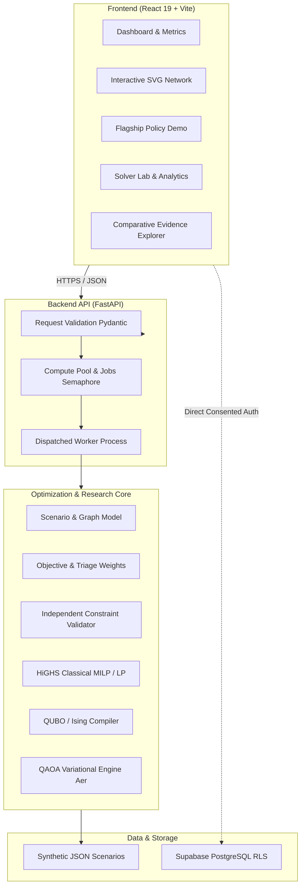

# BloodFlow-Q: Unified System Architecture

**Document Version:** 2.0  
**Status:** Consolidated Release Candidate  
**Target Environment:** Local Python 3.12+ / Node 20+ / Vercel Edge / Supabase PostgreSQL

---

## 1. System Overview

BloodFlow-Q is an emergency healthcare logistics research platform designed to optimize multi-facility blood allocation during normal operations and acute crises. The architecture separates mathematical modeling, classical optimization baselines, variational quantum algorithms, independent feasibility validation, and interactive user-facing visual applications.

---

## 2. Component Subsystems

### 2.1 Optimization & Algorithmic Core
1. **Mathematical Model (`optimization/models.py`):**
   Defines `Scenario`, `BloodBank`, `Hospital`, `Route`, `Urgency`, and `AllocationVariable`. Ensures non-negative inventories, integer shipment quantities, and biological ABO group compatibility rules.
2. **Objective Function (`optimization/objective.py`):**
   Computes multi-criteria trade-offs:
   $$\min \quad w_{\text{cost}} \cdot \text{Cost} + w_{\text{time}} \cdot \text{Time} + w_{\text{unmet}} \cdot \text{Unmet} + w_{\text{crit}} \sum \mu_i \cdot \text{Unmet}_{\text{crit}}$$
3. **Independent Feasibility Validator (`optimization/constraints.py`):**
   Validates decoded candidates against hard conservation laws:
   - Shipments from bank $b$ for group $g$ cannot exceed inventory $S_{b, g}$.
   - Hospital demand satisfaction cannot exceed requested quantities (no waste).
   - Routes marked `blocked` must carry 0 units.
   - Decoded candidates are **never secretly repaired**; violated constraints are explicitly cataloged.
4. **Classical Baselines (`optimization/milp.py`):**
   - High-performance Mixed Integer Linear Programming (MILP) using SciPy HiGHS.
   - Continuous Linear Programming (LP) relaxation method `solve_relaxation` providing initial fractional baselines and warm-start seeds.
   - Heuristics: `GreedyAllocator` (priority-first descent) and `ExactAllocator` (exhaustive state evaluation capped at 50,000 states).
5. **Quantum Formulation (`quantum/qubo.py` & `quantum/ising.py`):**
   - Bounded binary register decomposition for continuous flow variables.
   - Quadratic equality penalty transformation with conservative objective bounds:
     $$P > \sum \text{bounds} \times \text{costs} + \sum \text{demands} \times \text{unmet}$$
   - Exact mapping from binary quadratic forms to `qiskit.quantum_info.SparsePauliOp` Ising Hamiltonians ($Z$ and $ZZ$ Pauli terms).
6. **Variational QAOA Engine (`quantum/qaoa_solver.py`):**
   - Standard Ansatz: $H^{\otimes n}$ uniform superposition + alternating cost and $X$ mixer layers.
   - Warm-Start Ansatz: Product state initialized from continuous LP relaxation angles $\theta_i = 2 \arcsin(\sqrt{p_i})$ with boundary regularization $\epsilon \in (0, 0.5)$.
   - Mixer Gates: XY-mixer and parameterized transverse mixers preserving initial warm-state support.
   - Optimization: Local classical minimization (`COBYLA`, `Nelder-Mead`) with deterministic multi-restart routines ($1 \le r \le 10$).

### 2.2 Backend Sandboxing & Safety Layer
* **Process Isolation (`backend/jobs.py`):**
  In production, heavy optimization calls (`/optimize`, `/simulate-emergency`, `/demo-run`, `/demo/flagship`) are offloaded to dedicated worker processes spawned via `multiprocessing.Process`. Development and explicitly injected test services execute in-process; production isolation is enabled by `create_app` when no service is injected.
* **Resource Limits:**
  - `_SLOTS = threading.BoundedSemaphore(2)` restricts concurrent heavy computations.
  - Production isolated jobs have hard 60-second execution deadlines with automated process termination (`kill`) to protect against frozen simulator runs; in-process development calls do not have this worker-termination deadline.
  - Maximum request body size is capped at 1 MiB (`bound_request_body` middleware).

### 2.3 User Interface & Presentation Shell
* **Modern Shell (`frontend/src/App.jsx`):**
  Features lazy-loaded modular pages, ambient ECG heartbeat canvas (`HeartbeatBackground.jsx`), floating macOS-style dock (`Dock.jsx`), and animated switches (`SquishSwitch.jsx`).
* **Interactive Network Map (`frontend/src/pages/Network.jsx`):**
  Full SVG-based interactive graph supporting smooth pan, zoom, bounding-box centering, category filtering, and real-time shipment overlay.
* **Flagship Demonstration (`frontend/src/components/FlagshipDemo.jsx`):**
  Interactive policy workbench contrasting "service-first" clinical triage against "weighted-cost" mathematical minimization across a two-bank, two-hospital network.
* **Research & Evidence Hub (`frontend/src/components/ComparativeEvidenceExplorer.jsx`):**
  Interactive 6-stage visualization guiding users through scenario formulation, algebraic QUBO compilation, Aer quantum circuit sampling, and empirical classical comparisons.
